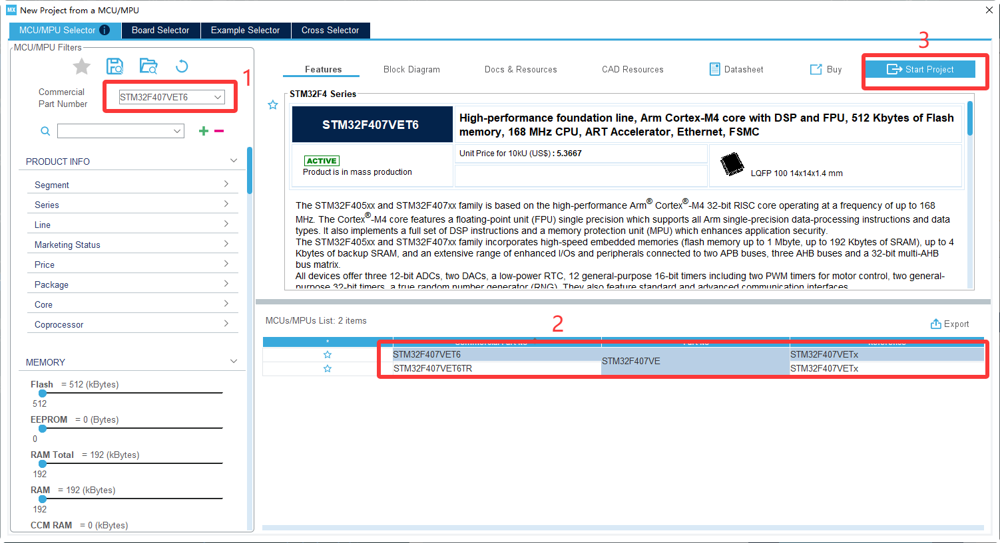
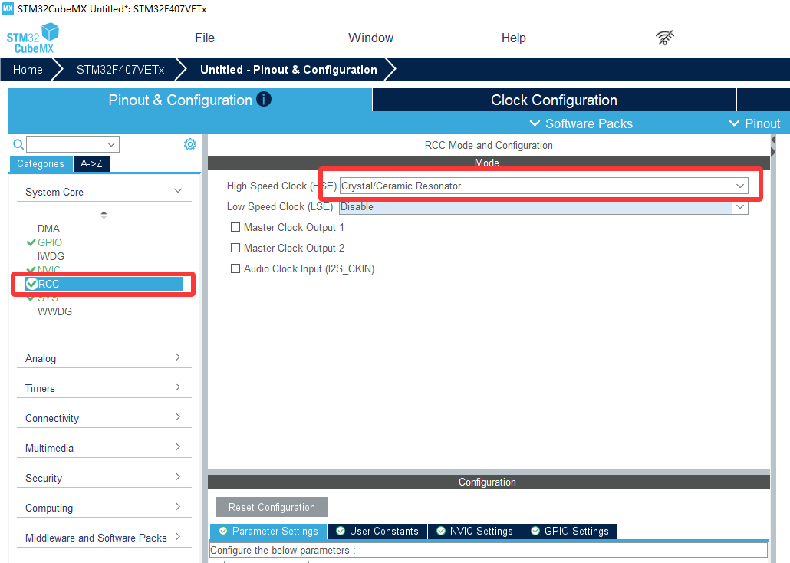
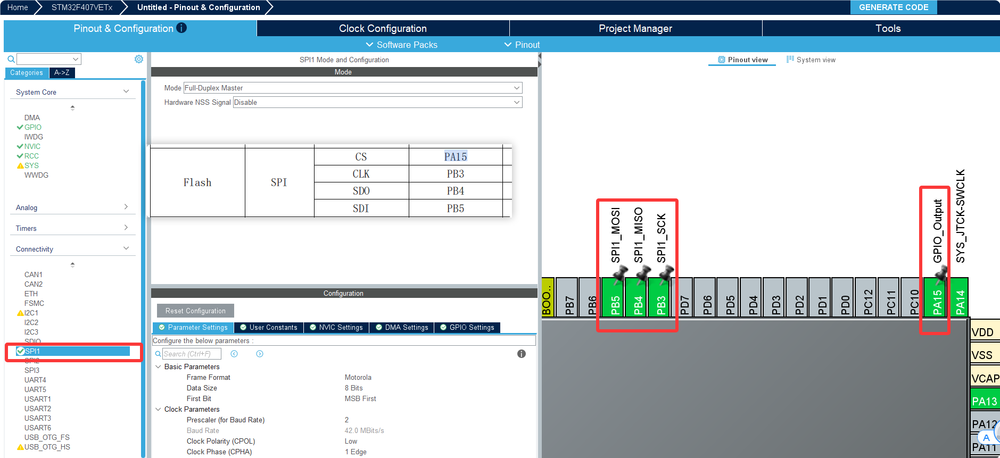
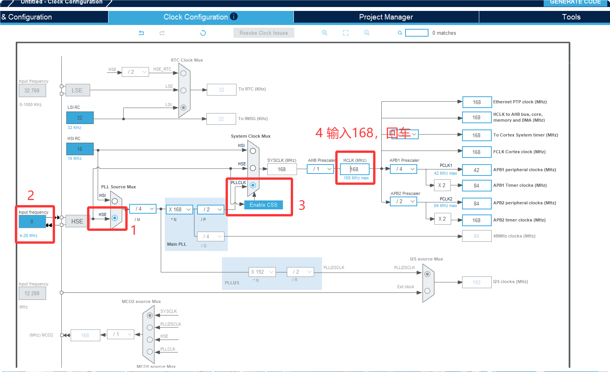
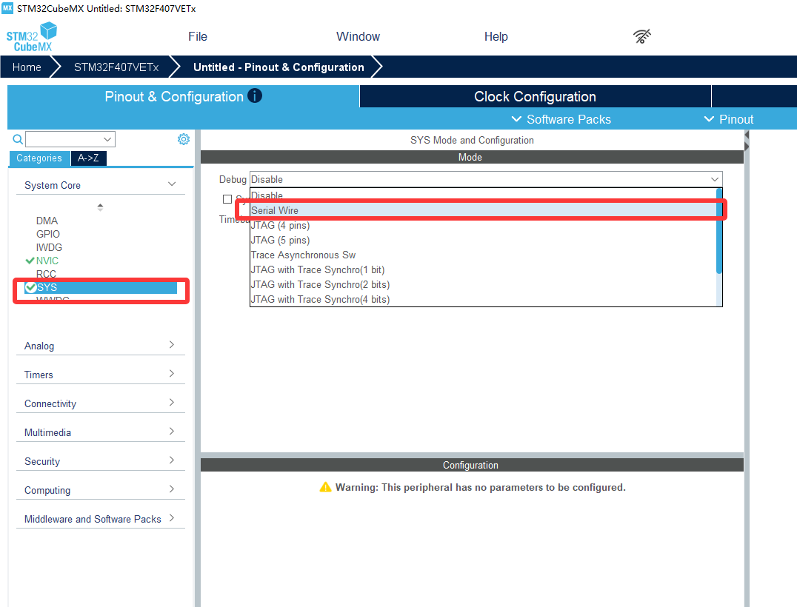

# SPI 驱动协议——用 SPI 总线读写 W25Q64 FLASH 与 TF 卡（基于 STM32F407VET6 + STM32CubeMX）

> **本章参考资料**：《STM32F4xx 中文数据手册》SPI 引脚复用表（Table 9 Alternate function mapping）、《RM0090 STM32F407 参考手册》SPI/I2S 章节、《W25Q64FV 数据手册》（指令集与时序）、《SD Specifications Part 1 Physical Layer Simplified Specification》（SPI 模式）、《SD 卡 SPI 模式应用笔记》，以及野火《STM32 HAL 库开发实战指南——基于霸天虎开发板》**第 24 章 SPI-读写串行 FLASH**（本章的协议讲解、指令表与驱动写法均以此为基础改写并扩展到 TF 卡）。
> **学习提示**：配合参考手册中 `SPI_CR1`（CPOL/CPHA/MSTR/BR/SPE/SSI/DFF）、`SPI_CR2`（中断与 DMA 使能）、`SPI_SR`（TXE/RXNE/BSY/OVR/MODF）三个寄存器的说明一起阅读，效果更佳。**SPI 寄存器只有三个主力，比 I2C 简单，但要真正吃透"全双工"和"四种模式"这两件事。**
> **特别说明**：本笔记以 **STM32F407VET6**（LQFP100 封装）资源讲解，外设配置全部通过 **STM32CubeMX** 完成，代码基于 **STM32 HAL 库**，所有实验结果**通过 USART1 + printf 输出到串口助手**（115200-8-N-1）。
> **本项目的两件被驱动对象**：
> ① **W25Q64**（8MB 串行 NOR FLASH），使用引脚 **PA15、PB3、PB4、PB5**；
> ② **TF 卡（microSD）**，使用引脚 **PA4、PA5、PA6、PA7**。
> **重要预警**：这两组引脚在 STM32F407 上**都通向 SPI1**，因此**不能简单地把两个器件都挂到 SPI1 上**。本笔记在"任务一的环节二"里专门拆解这道冲突题，并给出经过验证的定案：**FLASH 走 SPI3、TF 卡走 SPI1**。请务必先读懂那一节，后面所有代码都是按这个定案写的。

---

> **笔记结构说明（五级组织法）**
> 本笔记按 **项目（一级标题）→ 任务（二级标题）→ 环节（三级标题）→ 技能点（四级标题）→ 知识点（五级标题）** 逐层拆解。
> ① 一级只有 1 个，就是"项目"本身；
> ② 二级是 8 个可独立验收的"任务"，按"**认知 → 建工程 → 驱动 FLASH → 驱动 TF 卡 → 集成收尾**"由浅入深排列；
> ③ 三级本应叫"工序"，但本项目是"先设计、再编码、后验证"的软件开发流程，叫工序（偏制造语境）不够贴切，**故全文统一用"环节"替代"工序"**；
> ④ 四级"技能点"回答"**这一步要会做什么**"，五级"知识点"回答"**为什么这么做**"。技能点看代码与操作，知识点看原理与坑。

---

## 项目全景：一图看懂本笔记的任务链

```
                    ┌────────────────────────────────────────────┐
   项目 SPI-STORAGE │  用一条 SPI 总线体系，把"片外存储"用起来    │
                    └───────────────────┬────────────────────────┘
                                        │
   任务一 导入与拆解 ──────────────────►│  需求 → 引脚约束 → 引脚分配表
   任务二 协议认知   ──────────────────►│  四根线 + 四种模式 + 速率账
   任务三 外设认知   ──────────────────►│  框图 + 寄存器 + HAL 句柄
   任务四 工程搭建   ──────────────────►│  CubeMX：SPI3 + SPI1 + GPIO + USART1
   任务五 FLASH 驱动 ──────────────────►│  指令集 + 擦 + 写 + 读 + 联调校验
   任务六 TF 卡初始化 ─────────────────►│  CMD0 → CMD8 → ACMD41 → CMD58
   任务七 TF 卡读写  ──────────────────►│  CMD17 读块 / CMD24 写块
   任务八 集成与收尾 ──────────────────►│  双外设共存 + 容错 + 验收清单
```

**表 0-1 本项目任务清单与验收标准**

| 任务 | 名称 | 一句话目标 | 验收标准 |
| --- | --- | --- | --- |
| 一 | 项目导入与需求拆解 | 把需求翻译成引脚、外设与验收指标 | 产出一张无冲突的引脚分配表 |
| 二 | SPI 协议认知 | 说清物理层与协议层 | 能画出模式 0/3 的时序并说明采样沿 |
| 三 | STM32 SPI 外设认知 | 看懂框图、寄存器与 HAL 封装 | 能默写主机收发四步流程 |
| 四 | CubeMX 工程搭建 | 生成可编译的工程骨架 | CubeMX 无引脚告警、编译 0 错误 |
| 五 | W25Q64 驱动开发与联调 | 实现 ID/擦/写/读并完成回环校验 | 校验一致、掉电后数据完好 |
| 六 | TF 卡 SPI 初始化 | 把卡从 SD 模式切到 SPI 模式 | `TF_Init()` 返回 OK 并识别出容量类型 |
| 七 | TF 卡扇区读写 | 单块读、单块写 | 扇区回环校验一致 |
| 八 | 项目集成与收尾 | 双器件共存、容错、可维护 | 上电自检全部通过、异常可定位 |

---

## 任务一　项目导入与需求拆解

> **本任务的目标**：先不动代码，把"要做成什么样"想清楚。**嵌入式项目里 80% 的返工来自引脚与外设没提前核对**，这一步做好了，后面写代码是顺水推舟。

### 环节一　读任务书：把功能需求翻译成验收标准

#### 技能点 1　明确"写得进、读得出、掉电不丢"三条验收线

##### 知识点 1　功能需求的三个层次

一个"能读写 FLASH"的项目，需求其实分三层，很多初学者只做到第一层就以为完工了：

**表 1-1 需求的三层拆解**

| 层次              | 需求描述            | 对应验收动作             | 常见"假完成"                          |
| --------------- | --------------- | ------------------ | -------------------------------- |
| 第一层：**通得上**     | 总线能收到芯片应答       | 读 JEDEC ID 与手册比对   | ID 读出来是 `0xFF`/`0x00`，靠"重插一下"蒙过去 |
| 第二层：**写得进、读得出** | 数据能落到存储介质并能原样取回 | 写一段数据 → 读回 → 逐字节比对 | 只打印了"写入成功"，没做回环比对                |
| 第三层：**掉电不丢**    | 断电重启后数据仍然在      | 写完断电 10s 再上电读取     | 写进了 RAM 缓冲区，压根没落盘                |

> **为什么强调第三层**：FLASH 的全部价值就在"非易失"。本项目的验收脚本必须包含"**断电重启后重新读一遍**"这一步——它能一次性筛掉"缓存没落盘""擦除没生效""写保护位没清"这三类隐蔽 bug。

##### 知识点 2　两块存储介质的角色分工

W25Q64 是**裸 FLASH 芯片**，TF 卡是**带控制器的可插拔存储卡**，二者看似都是"存数据"，工程定位完全不同：

**表 1-2 W25Q64 与 TF 卡的分工**

| 维度 | W25Q64（片外 NOR FLASH） | TF 卡（microSD） |
| --- | --- | --- |
| 介质本质 | 裸 NOR FLASH 阵列 | NAND FLASH + **卡内控制器**（含坏块管理与磨损均衡） |
| 容量 | 8 MB，焊接在板上 | 常见 8GB~512GB，可插拔更换 |
| 访问单位 | 1 字节可读，写必须按页（256B），擦必须按扇区（4KB） | 一律 512 字节一个"块" |
| 引脚 | 4 根（CS/CLK/DO/DI） | 4 根（CS/SCK/MISO/MOSI，SPI 模式） |
| 谁管坏块 | **用户程序自己管** | 卡内控制器管，用户看不到 |
| 典型用途 | 存参数、字库、图片、日志（小容量高频读写） | 存文件、录音、图片（大容量、配文件系统） |

> **一句话记住分工**：**W25Q64 适合"程序自己直接管地址"的场景，TF 卡适合"交给文件系统管"的场景**。这也是为什么本笔记的 FLASH 部分直接操作地址，而 TF 卡部分最后会引向 FatFs。

#### 技能点 2　从需求里提取硬约束

##### 知识点 1　引脚是硬约束，速率是软约束

在 STM32 上，"用哪个引脚"往往在画板那一刻就焊死了，软件改不了；而"跑多快"是可以在代码里调的。所以拆解需求时，**先锁死引脚，再谈速率**。

本项目的硬约束清单：

1. **W25Q64 固定接 PA15、PB3、PB4、PB5**——板上已经连好，改动不了；
2. **TF 卡固定接 PA4、PA5、PA6、PA7**——卡座走线已定；
3. **调试口必须保留**——否则程序跑飞了没法下载，这条比前两条更"硬"。

##### 知识点 2　容量的算法：8MB 从哪来

W25Q64 的名字里藏着容量：**64 = 64 Mbit**，换算成字节要除以 8：

```
W25Q64 容量 = 64 Mbit ÷ 8 = 8 MByte = 8 × 1024 × 1024 = 8 388 608 字节
```

由容量派生出存储组织的全部数字（**这张表要背下来，写驱动时会反复用**）：

**表 1-3 W25Q64 的存储组织**

| 单位 | 大小 | 数量 | 首地址范围 | 用途 |
| --- | --- | --- | --- | --- |
| 页（Page） | 256 B | 32 768 页 | 0x000000 ~ 0x7FFF00 | **写操作的最小单位**（页写一次最多 256B） |
| 扇区（Sector） | 4 KB | 2 048 个 | 0x000000 ~ 0x7FF000 | **擦除的最小单位**（扇区擦除指令 0x20） |
| 块（Block） | 64 KB | 128 个 | 0x000000 ~ 0x7F0000 | 大块擦除（块擦除指令 0xD8），1 块 = 16 扇区 |
| 整片（Chip） | 8 MB | 1 片 | 0x000000 ~ 0x7FFFFF | 整片擦除（0xC7），耗时几十秒 |

> **为什么要 24 位地址**：8MB = 2²³ 字节，用 A23~A0 共 24 位地址刚好覆盖（最高地址 0x7FFFFF，实际只用 23 位）。所以 W25Q64 的地址一律按 **3 字节、高位在前** 发送——这也是后面代码里 `(addr >> 16) & 0xFF` 这种写法的由来。

---

### 环节二　清点芯片资源：SPI 外设与引脚映射

#### 技能点 1　查表选外设：先看清 F407 有哪几条 SPI 总线

##### 知识点 1　STM32F407VET6 的 SPI 资源与引脚表

F407 有 **3 个 SPI 外设**：SPI1 挂在 **APB2（PCLK2 = 84MHz）**，SPI2/SPI3 挂在 **APB1（PCLK1 = 42MHz）**。SCK 的最高频率是所在总线时钟的 1/2，所以 **SPI1 最快 42MHz，SPI2/SPI3 最快 21MHz**。

（野火第 24 章表 24-2 给出的 42Mbit/s / 21Mbit/s 是按 F103 的 72MHz 体系算的，换到 F407 的 84MHz 体系要按下面这张表理解——**看教程先看芯片型号**。）

**表 1-4 STM32F407VET6 的 SPI 引脚映射（LQFP100 可用引脚）**

| 外设 | 所在总线 | 最高 SCK | NSS（片选） | SCK | MISO | MOSI |
| --- | --- | --- | --- | --- | --- | --- |
| **SPI1** | APB2（84MHz） | 42 MHz | **PA4 / PA15** | **PA5 / PB3** | **PA6 / PB4** | **PA7 / PB5** |
| SPI2 | APB1（42MHz） | 21 MHz | PB12 / PB9 | PB13 / PB10 | PB14 / PB11 / PC2 | PB15 / PB12 / PC3 |
| SPI3 | APB1（42MHz） | 21 MHz | **PA15 / PA4** | **PB3 / PC10** | **PB4 / PC11** | **PB5 / PC12** |

> **把本项目的两组引脚套进表里，问题立刻就显形了**：
> - W25Q64 的 PA15/PB3/PB4/PB5 → 命中 **SPI1 的第二组引脚**，也命中 **SPI3 的唯一那组引脚**；
> - TF 卡的 PA4/PA5/PA6/PA7 → 命中 **SPI1 的第一组引脚**。
> 也就是说，**这两组引脚都通向 SPI1**。这就是下一节要解决的核心矛盾。

##### 知识点 2　AF5 与 AF6：同一组引脚的两副面孔

STM32 的引脚是"复用"的：同一个物理引脚，靠寄存器里写入的 **AF 编号（Alternate Function number）** 决定它此刻听谁指挥。F407 上：

- **SPI1、SPI2、SPI4、SPI5、SPI6 → AF5**
- **SPI3 → AF6**（I2S3 也是 AF6，很容易搞混）

所以 **PA15/PB3/PB4/PB5 这四根线，既能被配成 SPI1（AF5），也能被配成 SPI3（AF6）**——但**同一时刻只能是一个**。

```
        PA15 ─┬─ AF5 ──► SPI1_NSS
              └─ AF6 ──► SPI3_NSS        ← 二选一，寄存器里只能写一个值
        PB3  ─┬─ AF5 ──► SPI1_SCK
              └─ AF6 ──► SPI3_SCK        ← 二选一
```

> **这正是 STM32 复用机制带来的"自由度"**：正因为这组线能在 SPI1/SPI3 之间二选一，我们才有机会把两个器件分给两条总线而不改硬件。**如果它们只支持 AF5，本项目就无解，只能改板。**

#### 技能点 2　解决引脚冲突：这道题必须答对

##### 知识点 1　一个 SPI 外设只能选一组引脚

这是新手最容易忽略、排查时最痛苦的一条规则：

> **SPI1 只有一套 SCK/MISO/MOSI 输出电路。它要么从 PA5/PA6/PA7 出去，要么从 PB3/PB4/PB5 出去，不可能"同时从两边出去"。**

**表 1-5 三种方案的可行性分析**

| 方案                | 做法                                          | 可行性       | 代价                                                               |
| ----------------- | ------------------------------------------- | --------- | ---------------------------------------------------------------- |
| 方案 A：都用 SPI1      | FLASH 接 PA15/PB3~PB5，TF 卡接 PA4~PA7          | ❌ **不可行** | 两套 SCK 抢同一路输出，必有一端收不到时钟                                          |
| 方案 B：分时复用 SPI1    | 先配 SPI1 到第一组引脚做 flash，再 DeInit 重配到第二组做 TF 卡 | ⚠️ 勉强可行   | 每次切换都要 `HAL_SPI_DeInit` + 重配 GPIO + `HAL_SPI_Init`，代码丑、易错、没法同时工作 |
| 方案 C：**一个器件一条总线** | **FLASH → SPI3（AF6）**，**TF 卡 → SPI1（AF5）**  | ✅ **推荐**  | 硬件不用改，两器件可同时在线，代码最干净                                             |

##### 知识点 2　定案：FLASH 挂 SPI3，TF 卡挂 SPI1

选方案 C 的理由，一句话就能说清：

> **PA4~PA7 这组线只能做 SPI1（因为 SPI3 没有 PA5/PA6/PA7 这几个引脚），所以 TF 卡必须占 SPI1；PA15/PB3~PB5 这组线两边都能做，那就让给 SPI3。**

```
                      ┌──────────────────────────┐
                      │      STM32F407VET6       │
                      │                          │
   W25Q64  CS#  ◄─────┤ PA15  (GPIO 输出)        │
   W25Q64  CLK  ◄─────┤ PB3   SPI3_SCK   (AF6)   │
   W25Q64  DO   ─────►│ PB4   SPI3_MISO  (AF6)   │
   W25Q64  DI   ◄─────┤ PB5   SPI3_MOSI  (AF6)   │
                      │                          │
   TF 卡   CS   ◄─────┤ PA4   (GPIO 输出)        │
   TF 卡   SCK  ◄─────┤ PA5   SPI1_SCK   (AF5)   │
   TF 卡   MISO ─────►│ PA6   SPI1_MISO  (AF5)   │
   TF 卡   MOSI ◄─────┤ PA7   SPI1_MOSI  (AF5)   │
                      └──────────────────────────┘
```

**表 1-6 本项目的最终引脚分配表（写进 CubeMX 之前先核对这张表）**

| 器件     | 信号            | STM32 引脚    | 引脚模式        | 复用编号          | 备注                  |
| ------ | ------------- | ----------- | ----------- | ------------- | ------------------- |
| W25Q64 | CS#（片选）       | **PA15**    | GPIO_Output | —             | 软件片选，低有效；需释放 JTDI   |
| W25Q64 | CLK           | **PB3**     | AF_PP       | **AF6**（SPI3） | 需释放 JTDO            |
| W25Q64 | DO（MISO）      | **PB4**     | AF_PP       | **AF6**（SPI3） | 需释放 NJTRST          |
| W25Q64 | DI（MOSI）      | **PB5**     | AF_PP       | **AF6**（SPI3） | PB5 不是 JTAG 引脚，无需释放 |
| TF 卡   | CS            | **PA4**     | GPIO_Output | —             | 软件片选，低有效            |
| TF 卡   | SCK           | **PA5**     | AF_PP       | **AF5**（SPI1） | —                   |
| TF 卡   | MISO          | **PA6**     | AF_PP       | **AF5**（SPI1） | —                   |
| TF 卡   | MOSI          | **PA7**     | AF_PP       | **AF5**（SPI1） | —                   |
| 调试     | SWDIO / SWCLK | PA13 / PA14 | SYS         | —             | **必须保留**，不要挪用       |

> **为什么不把片选也交给 SPI 外设的 NSS 引脚**：SPI 外设的硬件 NSS 只适合"总线上只有一个从机、且用标准时序"的场合。一旦总线上要挂多个器件，或者器件要求"命令之间拉高 CS 复位状态机"（W25Q64 和 TF 卡都属于这一类），就必须用**普通 GPIO 软件控制 CS**。野火第 24 章也明确采用软件 NSS（`SPI_NSS_SOFT`），本章沿用。

---

### 环节三　释放 JTAG 占用的引脚

#### 技能点 1　定位"三个被借走的引脚"

##### 知识点 1　PA15 / PB3 / PB4 复位后不是普通 IO

很多人卡在这里：CubeMX 里明明把 SPI3 配好了，烧录后 FLASH 毫无反应，读 ID 恒为 `0xFF`。**根因往往不是 SPI 配置错，而是这三个引脚上电后默认是 JTAG 调试口。**

**表 1-7 被 JTAG 默认占用的引脚**

| 引脚 | 复位默认功能 | 本项目要用它做 | 是否冲突 |
| --- | --- | --- | --- |
| PA13 | JTMS / **SWDIO** | 保留（调试用） | 保留 |
| PA14 | JTCK / **SWCLK** | 保留（调试用） | 保留 |
| **PA15** | **JTDI** | W25Q64 的 CS | ⚠️ **冲突，必须释放** |
| **PB3** | **JTDO / TRACESWO** | SPI3_SCK | ⚠️ **冲突，必须释放** |
| **PB4** | **NJTRST** | SPI3_MISO | ⚠️ **冲突，必须释放** |
| PB5 | 无（默认普通 IO） | SPI3_MOSI | 不冲突 |

##### 知识点 2　SWD 与 JTAG 的取舍

STM32F4 的调试接口支持两种协议，二者共用 PA13/PA14：

- **JTAG（5 线）**：需要 TMS/TCK/TDI/TDO/nTRST 共 5 根，占用 PA13/PA14/**PA15/PB3/PB4**；
- **SWD（2 线）**：只用 SWDIO(PA13)/SWCLK(PA14) 两根，**不占用 PA15/PB3/PB4**。

结论很直接：**本项目必须选 Serial Wire（SWD）**。选 SWD 后，PA15/PB3/PB4 会从调试口上"释放"出来，交还给 GPIO/复用功能。

> ⚠️ **特别注意**：CubeMX 的 Debug 选项里还有一个 **Trace Asynchronous Sw**，它会把 PB3 单独留下来当 TRACESWO 输出。**本项目不能选它**，否则 PB3 依然被占，SPI3 的时钟线没地方接。

#### 技能点 2　在 CubeMX 中完成释放

##### 知识点 1　SYS → Debug → Serial Wire

操作路径（CubeMX 5.x/6.x 一致）：

1. 左侧 **System Core → SYS**；
2. **Debug** 下拉框选 **Serial Wire**；
3. 此时芯片图上 PA13/PA14 会被标成 `SYS_JTMS-SWDIO` / `SYS_JTCK-SWCLK`，而 PA15/PB3/PB4 **重新变成可自由分配的浅色**；
4. 再去 **Connectivity → SPI3** 配置，PB3/PB4/PB5 才能被点亮。

> 📷 图 1-1 SYS → Debug → Serial Wire 设置界面（此处可插入截图）

##### 知识点 2　没释放时的典型现象（对照排查）

**表 1-8 JTAG 未释放时的现象与判别**

| 现象 | 判别方法 | 结论 |
| --- | --- | --- |
| 读 JEDEC ID 恒为 `0xFF` | 用示波器看 PB3 有无时钟 | 无时钟 → PB3 被 TRACESWO 占用 |
| 读 JEDEC ID 恒为 `0x00` | 量 PB4 电平 | MISO 被 JTAG 驱动为固定电平 |
| 编译下载后程序"跑飞" | 检查是否误用了 PA13/PA14 | SWD 引脚被重配成普通 IO，调试器失联 |
| CubeMX 里 PB3 选不到 SPI3_SCK | 看 SYS 的 Debug 设置 | 选成了 JTAG 或 Trace Asynchronous Sw |

> **排错口诀**：**"Pinout 里点不亮，先看 SYS 里选了什么"**。CubeMX 中任何"这个引脚怎么配不了 X 功能"的疑问，答案八成在 SYS、RCC 或某个已使能的外设身上。

---

### 环节四　编引脚分配表与接线检查

#### 技能点 1　编制引脚分配表并画接线图

##### 知识点 1　W25Q64 的接法（含 WP# 与 HOLD#）

W25Q64 一共有 8 个引脚（SOIC-8），除了四根 SPI 线，还有两根**容易漏接**的控制脚：

**表 1-9 W25Q64 引脚接法**

| W25Q64 引脚 | 全称 | 接到 | 说明 |
| --- | --- | --- | --- |
| CS# | Chip Select | **PA15** | 片选，低有效 |
| CLK | Serial Clock | **PB3** | 时钟 |
| DI（IO0） | Data In | **PB5** | 主机→FLASH（MOSI） |
| DO（IO1） | Data Out | **PB4** | FLASH→主机（MISO） |
| **WP#** | Write Protect | **3.3V**（10kΩ 上拉） | 低电平写保护；**不接会随机写失败** |
| **HOLD#** | Hold | **3.3V**（10kΩ 上拉） | 低电平暂停通讯；不接可能读到乱码 |
| VCC | 电源 | 3.3V + 100nF 去耦 | 不可接 5V |
| GND | 地 | GND | 与 MCU 共地 |

> **这两根脚为什么必须拉高**：`WP#` 悬空时引脚电平不确定，芯片可能进入写保护而**悄悄丢弃写入命令**（不报错、只表现为"读回来还是 0xFF"）；`HOLD#` 悬空时可能被误触发暂停，导致时钟还在走但数据不动。**新手 90% 的"写不进去"都出在这两根脚上。**

##### 知识点 2　TF 卡的接法（含上拉与卡座）

**表 1-10 TF 卡（SPI 模式）引脚接法**

| TF 卡引脚 | SPI 模式下的名称 | 接到 | 说明 |
| --- | --- | --- | --- |
| DAT2（1 脚） | — | 悬空或上拉 | SPI 模式不用 |
| CD/DAT3（2 脚） | **CS** | **PA4** | 片选，低有效；**建议 10kΩ 上拉** |
| CMD（3 脚） | **MOSI** | **PA7** | 主机→卡；建议 10kΩ 上拉 |
| VSS（4 脚） | GND | GND | 共地 |
| VDD（5 脚） | 电源 | **3.3V** + 10µF‖100nF | **严禁 5V**，会烧卡 |
| CLK（6 脚） | **SCK** | **PA5** | 时钟 |
| VSS（7 脚） | GND | GND | 共地 |
| DAT0（8 脚） | **MISO** | **PA6** | 卡→主机；建议 10kΩ 上拉 |

> **为什么 MISO 要上拉**：SPI 总线在"没有卡"或"卡未选中"时，MISO 处于**高阻态**。加了上拉，主机读到的稳定是 `0xFF`——**这恰好成了"卡在不在"的探测手段**：如果初始化时一直读不到有效响应，先量 MISO 有没有被上拉，就能快速区分"卡没插好"和"程序写错"。

#### 技能点 2　电气与接线检查清单

##### 知识点 1　上电前必查的五件事

1. **电平**：W25Q64 与 TF 卡都是 **3.3V 器件**，VCC 接 3.3V，不要接开发板的 5V 排针；
2. **共地**：TF 卡座、FLASH、MCU 必须共地，否则 MISO 采样基准漂移；
3. **上拉**：`WP#`、`HOLD#` 拉 3.3V；TF 卡的 CS/MOSI/MISO 建议各 10kΩ 上拉；
4. **去耦**：两颗器件的电源脚就近各放 100nF，TF 卡再并 10µF，抑制插拔瞬间的浪涌；
5. **不要动调试口**：PA13/PA14 保持给 SWD，任何情况下都不要挪作它用。

##### 知识点 2　走线与速率的关系

SPI 是**推挽驱动**（不像 I2C 是开漏），抗干扰能力比 I2C 强得多，但速率一高就讲究了：

- **SCK 走线尽量短**，避免与 PWM、电机驱动、DC-DC 开关节点并行；
- 走线超过 10cm 时，**先把速率降到 10MHz 以下**再排查问题；
- **MISO 是唯一的"单向回流"信号**，最容易受干扰，若出现偶发误码，优先怀疑 MISO 走线与地回流。

> 📷 图 1-2 本项目的实际接线照片（此处可插入实物图）

---

## 任务二　SPI 协议认知（物理层与协议层）

> **本任务的目标**：把 SPI 从"四根线"讲到"四种模式"，并且和学过的 I2C、串口做对比。**协议层的功夫全在时序图上，看懂一张图，后面所有驱动都是它的展开。**

### 环节一　物理层：四根线如何搭起一条总线

#### 技能点 1　认识四根信号线

##### 知识点 1　SCK / MOSI / MISO 的角色

SPI（Serial Peripheral Interface，串行外围设备接口）由 Motorola 提出，是一条**高速、全双工、同步**的串行总线。它用三根总线加若干根片选线：

**表 2-1 SPI 的四根信号线**

| 信号 | 全称 | 方向 | 作用 |
| --- | --- | --- | --- |
| **SCK** | Serial Clock | 主机 → 从机 | 时钟，**由主机产生**，决定通讯速率 |
| **MOSI** | Master Out Slave In | 主机 → 从机 | 主机发、从机收 |
| **MISO** | Master In Slave Out | 从机 → 主机 | 从机发、主机收 |
| **NSS** | Slave Select（也叫 CS、SS） | 主机 → 从机 | 片选，**低电平选中** |

一句话区分 SPI 与 I2C 的寻址方式：**I2C 靠"地址"找器件，SPI 靠"片选线"点器件**。

##### 知识点 2　NSS：SPI 里没有"地址"这个词

**SPI 协议本身不定义任何地址字段**。主机要跟哪个从机说话，就把那根从机的 NSS 拉低——就这么简单。这带来两个直接后果：

1. **一个从机需要一根独立的 NSS 线**：挂 4 个从机，主机就要多花 4 根 IO（SCK/MOSI/MISO 可以并联共用）。这也是 SPI 引脚数比 I2C 多的原因；
2. **NSS 的边沿就是通讯的起止信号**：`NSS 由高变低 = 起始`，`NSS 由低变高 = 停止`。从机在自己的 NSS 上检测到下降沿，就"知道自己被选中了"，开始准备收发。

```
NSS  ‾‾‾‾\_______________________________________________/‾‾‾‾‾
          ▲ 起始（选中）                        ▲ 停止（取消选中）
SCK  ________/‾\_/‾\_/‾\_/‾\_/‾\_/‾\_/‾\_/‾\________________
MOSI ______X D7 X D6 X D5 X D4 X D3 X D2 X D1 X D0 X________
MISO ______X D7 X D6 X D5 X D4 X D3 X D2 X D1 X D0 X________
```

> **工程习惯**：STM32 的 SPI 外设虽然有硬件 NSS，但**实际项目几乎都用普通 GPIO 软件控制**（`SPI_NSS_SOFT`）。原因有三：① 硬件 NSS 在多从机场景下不好用；② 有些器件要求"命令之间必须拉高 CS 复位内部状态机"；③ 软件控制便于在两条命令之间插入延时。**野火第 24 章、本笔记的 W25Q64 与 TF 卡驱动，全部使用软件片选。**

#### 技能点 2　多从机拓扑与电气特性

##### 知识点 1　一主多从的连接方式

```
                      ┌─────────┐  CS1
              ┌───────┤ 从机 1  │◄──── 主机 IO1
              │       └─────────┘
   ┌──────┐   │       ┌─────────┐  CS2
   │ 主机 │───┼───────┤ 从机 2  │◄──── 主机 IO2
   └──────┘   │       └─────────┘
   SCK/MOSI   │       ┌─────────┐  CS3
   /MISO ─────┴───────┤ 从机 3  │◄──── 主机 IO3
                      └─────────┘
        （三根总线并联，NSS 各自独占）
```

**关键规则**：同一时刻**只能拉低一根 NSS**。如果同时选中两个从机，它们会一起往 MISO 上驱动数据，形成**总线冲突**——轻则数据错乱，重则两个输出级对打、芯片发热。

##### 知识点 2　推挽输出：SPI 比 I2C"硬气"的原因

| 特性 | SPI | I2C |
| --- | --- | --- |
| 输出结构 | **推挽**（CMOS 互补） | **开漏 + 上拉电阻** |
| 驱动能力 | 强，可高速翻转 | 弱，靠电阻拉高，上升沿受限 |
| 需要上拉吗 | 不需要（但建议加保护/防浮空） | **必须** |
| 多设备挂同一根线 | 只有 MISO/MOSI/SCK 可并联，**靠片选隔离** | 全部并联，**靠地址隔离** |
| 典型速率 | 数十 MHz | 100k ~ 400k |
| 线数 | 4 根起 | 2 根 |

> **一句话理解**：**I2C 是"开漏总线、大家共享、靠地址点名"，SPI 是"推挽点对点、靠片选放行"。** 所以 SPI 更快但更费引脚，I2C 更省但更慢。

---

### 环节二　协议层：起始、采样与停止

#### 技能点 1　读懂一次完整传输

##### 知识点 1　NSS 拉低即起始、拉高即停止

一次 SPI 事务（transaction）的完整骨架：

1. **主机拉低目标从机的 NSS** —— 起始；
2. 主机产生 SCK 时钟，同时把数据一位一位地从 MOSI 送出、从 MISO 收回；
3. **数据在 SCK 的某个边沿被采样**（哪个边沿由 CPHA 决定，详见下一技能点）；
4. 传完约定字节数后，**主机拉高 NSS** —— 停止，从机取消选中。

**每一次字节传输 = 8 个 SCK 周期**。8 位传完，`TXE`（发送缓冲空）与 `RXNE`（接收缓冲非空）标志都会置起。

##### 知识点 2　全双工：发与收同步进行

这是 SPI 最容易被误解、也最容易写错驱动的一点：

> **SPI 没有"只读"这个动作。主机的每一个时钟周期，都在"同时"发送 1 位、接收 1 位。**

所以"读一个字节"在硬件上的真实动作是：**主机发送一个任意字节（惯用 `0xFF`）以产生 8 个时钟，从机借此把这 8 位数据移出来，主机在接收缓冲里取走它**。

```c
/* 这就是为什么"读"要发一个 Dummy 字节 */
#define SPI_DUMMY_BYTE   0xFF

uint8_t SPI_ReadByte(void)
{
  uint8_t dummy = SPI_DUMMY_BYTE;
  uint8_t rx    = 0;
  HAL_SPI_TransmitReceive(&hspi3, &dummy, &rx, 1, 100);  /* 发 dummy，收真数据 */
  return rx;
}
```

> **Dummy 字节为什么常用 `0xFF`**：从机在 MISO 上输出数据时，MOSI 上的值通常被它忽略；用 `0xFF`（全 1）可以在总线空闲时保持 MOSI 高电平，与"空闲态"一致，副作用最小。**用 0x00 也能工作，但部分器件在片选期间对 MOSI 电平敏感，习惯上统一用 0xFF。**

#### 技能点 2　理解 CPOL 与 CPHA：四种模式的由来

##### 知识点 1　时钟极性（CPOL）与时钟相位（CPHA）

SPI 有四种工作模式，由两个参数组合而成：

- **CPOL（Clock Polarity，时钟极性）**：**空闲时** SCK 是高还是低。`CPOL=0` 空闲为低，`CPOL=1` 空闲为高；
- **CPHA（Clock Phase，时钟相位）**：数据在**第几个边沿**被采样。`CPHA=0` 在**奇数边沿**（第 1、3、5… 个）采样，`CPHA=1` 在**偶数边沿**（第 2、4、6… 个）采样。

> **注意"奇数边沿"不等于"上升沿"**：当 CPOL=0 时奇数边沿是上升沿，当 CPOL=1 时奇数边沿是下降沿。**所以采样沿不是由上升/下降决定的，而是由"第几个边沿"决定的**——这是野火第 24 章特别强调、也是初学者最容易记混的一句。

**表 2-2 SPI 的四种模式**

| 模式 | CPOL | CPHA | 空闲时 SCK | 采样时刻 | 数据切换时刻 | 典型器件 |
| --- | --- | --- | --- | --- | --- | --- |
| **模式 0** | 0 | 0 | 低电平 | 奇数边沿（上升沿） | 偶数边沿（下降沿） | **TF 卡（SD SPI 模式）**、多数传感器 |
| 模式 1 | 0 | 1 | 低电平 | 偶数边沿（下降沿） | 奇数边沿（上升沿） | 部分 ADC |
| 模式 2 | 1 | 0 | 高电平 | 奇数边沿（下降沿） | 偶数边沿（上升沿） | 少见 |
| **模式 3** | 1 | 1 | 高电平 | 偶数边沿（上升沿） | 奇数边沿（下降沿） | **W25Q64（也可用模式 0）** |

**模式 0 的时序（本项目 TF 卡用）**：

```
NSS   ‾‾‾\_________________________________________/‾‾‾
SCK   ______/‾\_/‾\_/‾\_/‾\_/‾\_/‾\_/‾\_/‾\________
            ↑ ↑ ↑ ↑                        （CPOL=0，空闲低）
MOSI  ──X═D7═X═D6═X═ … ═X═D0═X──────────
          ↑ 在上升沿采样（CPHA=0，奇数边沿）
```

**模式 3 的时序（本项目 W25Q64 用，与野火第 24 章一致）**：

```
NSS   ‾‾‾\_________________________________________/‾‾‾
SCK   ‾‾‾\___/‾‾‾\___/‾‾‾\___/‾‾‾\___/‾‾‾\___/‾‾‾\___
           ↑   ↑   ↑   ↑                 （CPOL=1，空闲高）
MOSI  ──X═D7═X═D6═X═ … ═X═D0═X──────────
            ↑ 在上升沿采样（CPHA=1，偶数边沿）
```

##### 知识点 2　四种模式与"两端必须同模式"

**这是 SPI 调试时出现频率最高的故障源**：

> **主机与从机必须工作在同一个模式，否则读出来的数据永远是错的（通常是全部错位、或首尾各错一位）。**

**表 2-3 两端模式不匹配时的典型症状**

| 主机 | 从机 | 现象 |
| --- | --- | --- |
| 模式 3 | 模式 0 | 数据位整体错开半个时钟，读 ID 得到 `0x7F/0x3F` 之类"像但不完全像"的值 |
| 模式 0 | 模式 3 | 首字节丢失或末字节丢一位 |
| 任一 | 任一 | 偶尔能通、偶尔不通（时序处于临界，受温度/走线影响） |

> **排错方法**：先用**模式 0**（最通用）试，不通再换**模式 3**。W25Q64 两种都支持（手册写着 SPI Mode 0 和 Mode 3），TF 卡在 SPI 模式下**只支持模式 0**。这就是本项目两条总线用不同模式的原因——**不是随便配的，是被器件手册规定的**。

---

### 环节三　横向对比与速率账：SPI 到底有多快

#### 技能点 1　三条总线的选型逻辑

##### 知识点 1　SPI / I2C / UART 对照表

**表 2-4 常用三种板级总线的对比**

| 维度 | SPI | I2C | UART |
| --- | --- | --- | --- |
| 同步方式 | **同步**（有 SCK） | **同步**（有 SCL） | **异步**（无时钟，靠波特率约定） |
| 双工方式 | **全双工**（MOSI/MISO 独立） | 半双工（SDA 一根双向） | 全双工（TX/RX） |
| 线数 | 4 根起（每从机多 1 根 CS） | 2 根 | 2 根（TX/RX）+ GND |
| 拓扑 | 一主多从（片选） | 多主多从（地址+仲裁） | 点对点 |
| 速率 | 数 MHz ~ 数十 MHz | 100k ~ 400k | 9.6k ~ 数 M |
| 引脚成本 | 高 | 低 | 低 |
| 典型器件 | FLASH、LCD、SD 卡、无线模块、ADC | EEPROM、传感器、RTC | 调试口、GPS、蓝牙 |

**选型口诀**：**要快选 SPI，要省引脚选 I2C，要跨设备远距离/接电脑选 UART。**

#### 技能点 2　算清速率账：21MHz 有多快

##### 知识点 1　SCK 频率与字节速率的关系

SPI 每 8 个 SCK 周期传 1 字节，所以：

```
字节速率 = SCK 频率 ÷ 8
```

本项目的两条总线：

| 总线 | 所在 APB | 总线时钟 | 分频 | SCK | 字节速率 |
| --- | --- | --- | --- | --- | --- |
| SPI3（W25Q64） | APB1 | 42 MHz | ÷2 | **21 MHz** | ≈ 2.6 MB/s |
| SPI1（TF 卡） | APB2 | 84 MHz | ÷4 | **21 MHz** | ≈ 2.6 MB/s |
| SPI1（TF 卡初始化） | APB2 | 84 MHz | ÷256 | **328 kHz** | ≈ 41 KB/s |

> **TF 卡为什么初始化阶段必须降到 328kHz**：SD 规范规定，**卡在上电初始化期间（识别、协商阶段）SCK 不得超过 400kHz**，只有识别完成、进入数据传输状态后才可以提速到 25MHz。分频 ÷256 得 328kHz，刚好卡在红线以下——**这就是 CubeMX 里 SPI1 初值填 256 分频的原因，不是随便填的**。

##### 知识点 2　把时间算到擦除与编程上：FLASH 慢在哪

新手常以为"SPI 21MHz 很快，写 8MB 也就 3 秒"。**错的**。FLASH 的瓶颈从来不在总线，而在**芯片内部的擦除与编程**：

**表 2-5 写满 8MB 的时间账**

| 环节 | 单位耗时（典型值） | 数量 | 合计 |
| --- | --- | --- | --- |
| 总线传输（21MHz） | 8MB ÷ 2.6MB/s | 1 次 | ≈ **3.2 s** |
| 页编程（256B/页） | 0.7 ms | 32 768 页 | ≈ **23 s** |
| 扇区擦除（4KB） | 45 ms | 2 048 个 | ≈ **92 s** |
| 整片擦除 | — | 1 次 | ≈ **20 s**（一次性，不用 2048 次扇区擦） |

> **结论**：**写 FLASH 的时间 99% 花在"等芯片内部干活"上，总线速度再快也没用。** 这直接决定了三件事：① 驱动里必须有"**忙等待**"（查状态寄存器 BUSY 位）；② 大批量写要尽量用"整片擦除 + 连续页写"而不是"逐扇区擦 + 写一个字节"；③ 若业务需要频繁改写小数据，**不该用裸 FLASH，要么加缓存，要么上文件系统**。

---

## 任务三　STM32 SPI 外设认知

> **本任务的目标**：从"协议"下沉到"外设"。协议规定"信号长什么样"，外设决定"寄存器怎么配"。**看懂框图 → 记住寄存器 → 理解 HAL 封装**，三步走完后，CubeMX 里每个勾选项你都知道它在改哪个位。

### 环节一　功能框图：按信号流拆解

#### 技能点 1　画出 SPI 内部四大模块

##### 知识点 1　框图的四个部分

```
                    ┌───────────────────────────────────────────────┐
   地址/数据总线 ──►│  ┌─────────┐   ┌──────────┐   ┌────────────┐  │
                    │  │ 控制逻辑 │──►│ 波特率    │──►│  SCK 输出  │──┼──► SCK
                    │  │ CR1/CR2 │   │ 发生器    │   └────────────┘  │
                    │  └────┬────┘   └──────────┘                    │
                    │       │                                        │
                    │       ▼                                        │
                    │  ┌─────────┐      ┌──────────────────────┐    │
   数据寄存器 DR ◄──┼──┤ 发送缓冲 │─────►│  移位寄存器（8/16 位）│───┼──► MOSI
                    │  │ 接收缓冲 │◄─────┤   （MSB/LSB 先行）    │◄──┼─── MISO
                    │  └─────────┘      └──────────────────────┘    │
                    │                                                │
                    │  ┌──────────────────────────────────────┐     │
                    │  │  NSS 逻辑（硬件 NSS 或软件 SSI）      │─────┼──► NSS
                    │  └──────────────────────────────────────┘     │
                    └───────────────────────────────────────────────┘
```

四个模块与寄存器的对应关系：

**表 3-1 SPI 框图的四大模块**

| 模块 | 职责 | 相关寄存器位 |
| --- | --- | --- |
| **通讯引脚** | SCK/MOSI/MISO/NSS 的电气与复用 | 由 GPIO 的 AFR 决定，不在 SPI 寄存器里 |
| **时钟控制逻辑** | 从 f_pclk 分频出 SCK | `CR1.BR[2:0]`、`CR1.CPOL`、`CR1.CPHA`、`CR1.MSTR` |
| **数据控制逻辑** | 移位寄存器与收发缓冲 | `CR1.DFF`（8/16 位）、`CR1.LSBFIRST`、`DR` |
| **整体控制逻辑** | 状态机、中断、DMA、NSS | `CR1.SPE/SSI/SSM`、`CR2.*`、`SR.*` |

##### 知识点 2　数据是怎么"流"过去的

以发送 1 字节 `0xA5 = 1010 0101` 为例：

1. CPU 把 `0xA5` 写进 **DR**（数据寄存器），硬件把它送进**发送缓冲**；
2. 波特率发生器产生 SCK，**移位寄存器**在每个时钟沿把最高位（MSB 先行时）挪到 MOSI 上；
3. 8 个时钟后，`0xA5` 全部送出，**`SR.TXE` 置 1**（发送缓冲空了，可以再写下一个）；
4. 与此同时，MISO 上的 8 位数据被同一个移位寄存器**同步收进来**，送进接收缓冲，**`SR.RXNE` 置 1**；
5. CPU 读 DR 取走收到的字节。

> **为什么"发"和"收"共用一个移位寄存器**：这正是全双工的实现方式——**一根时钟沿，同时把一位推出去、把一位收进来**。理解这一点，就理解了为什么调 `HAL_SPI_Transmit()` 之后 DR 里会残留收到的数据、为什么"读"必须靠"发 dummy"来产生时钟。

#### 技能点 2　掌握 SCK 的分频关系

##### 知识点 1　BR[2:0] 的分频表

SCK 频率完全由 `CR1` 里的 `BR[2:0]` 三位决定，**只能是 2 的整数次幂分频**（不能任意分频）：

**表 3-2 BR[2:0] 分频对照（f_pclk 为所在 APB 总线时钟）**

| BR[2:0] | 分频 | HAL 宏 | SPI1 实际 SCK（84MHz） | SPI3 实际 SCK（42MHz） |
| --- | --- | --- | --- | --- |
| 000 | ÷2 | `SPI_BAUDRATEPRESCALER_2` | 42 MHz | 21 MHz |
| 001 | ÷4 | `SPI_BAUDRATEPRESCALER_4` | 21 MHz | 10.5 MHz |
| 010 | ÷8 | `SPI_BAUDRATEPRESCALER_8` | 10.5 MHz | 5.25 MHz |
| 011 | ÷16 | `SPI_BAUDRATEPRESCALER_16` | 5.25 MHz | 2.625 MHz |
| 100 | ÷32 | `SPI_BAUDRATEPRESCALER_32` | 2.625 MHz | 1.3125 MHz |
| 101 | ÷64 | `SPI_BAUDRATEPRESCALER_64` | 1.3125 MHz | 656 kHz |
| 110 | ÷128 | `SPI_BAUDRATEPRESCALER_128` | 656 kHz | 328 kHz |
| 111 | ÷256 | `SPI_BAUDRATEPRESCALER_256` | 328 kHz | 164 kHz |

> **注意**：**同一个分频值在不同 SPI 上得到的 SCK 完全不同**，因为 SPI1 挂 APB2(84MHz)、SPI2/3 挂 APB1(42MHz)。本项目 SPI3 取 ÷2 得 21MHz、SPI1 取 ÷4 得 21MHz——**看起来都是"21MHz"，但分频系数一个 2 一个 4**，别抄错。

##### 知识点 2　选分频的三条实践规则

1. **先查从机的上限**：W25Q64 标准读（03h）最高约 50MHz，TF 卡 SPI 模式最高 25MHz。本项目统一取 21MHz，两者都满足；
2. **初始化降速，通信提速**：TF 卡识别阶段必须 ≤400kHz，识别完再切 21MHz——这是**唯一需要"运行中改速率"的场合**；
3. **留余量**：实际能达到的最高速率受走线、上拉、从机器件影响。**调试期先降到 1~5MHz 跑通，再逐步提高**，比一上来就顶到 21MHz 撞运气要快得多。

---

### 环节二　寄存器与 HAL 句柄：两套语言对照

#### 技能点 1　读透 SPI_InitTypeDef

##### 知识点 1　结构体成员与含义

HAL 库把 SPI 的配置收进一个结构体（定义于 `stm32f4xx_hal_spi.h`）：

```c
typedef struct {
  uint32_t Mode;                /* 主/从模式：SPI_MODE_MASTER / SPI_MODE_SLAVE */
  uint32_t Direction;           /* 通讯方向：2LINES / 2LINES_RXONLY / 1LINE */
  uint32_t DataSize;            /* 数据帧长度：8BIT / 16BIT */
  uint32_t CLKPolarity;         /* 时钟极性 CPOL：LOW / HIGH */
  uint32_t CLKPhase;            /* 时钟相位 CPHA：1EDGE / 2EDGE */
  uint32_t NSS;                 /* 片选方式：SOFT / HARD */
  uint32_t BaudRatePrescaler;   /* 波特率分频 */
  uint32_t FirstBit;            /* MSB / LSB 先行 */
  uint32_t TIMode;              /* TI 模式（基本不用） */
  uint32_t CRCCalculation;      /* CRC 校验开关 */
  uint32_t CRCPolynomial;       /* CRC 多项式 */
} SPI_InitTypeDef;
```

**表 3-3 CubeMX 配置项 ↔ 结构体成员 ↔ 本项目取值**

| CubeMX 配置项 | 结构体成员 | 本项目取值（FLASH / TF 卡） | 说明 |
| --- | --- | --- | --- |
| Mode | `Mode` | Master / Master | 两块存储都是从机 |
| Direction | `Direction` | 2 Lines Full Duplex | 全双工 |
| Data Size | `DataSize` | 8 Bits | 两者都是 8 位帧 |
| Clock Polarity (CPOL) | `CLKPolarity` | **High / Low** | FLASH 模式 3、TF 卡模式 0 |
| Clock Phase (CPHA) | `CLKPhase` | **2 Edge / 1 Edge** | 同上 |
| NSS Signal Type | `NSS` | **Software** | 都用 GPIO 片选 |
| Prescaler | `BaudRatePrescaler` | **2 / 256（初值）** | TF 卡初始化必须降速 |
| First Bit | `FirstBit` | MSB First | 两者都是高位先行 |
| CRC Calculation | `CRCCalculation` | Disabled | 不用 SPI 硬件 CRC |

##### 知识点 2　两个容易被忽略的坑

> **坑一：`DataSize` 设成 16 位后，MISO 会"多发一个字节"**。因为 16 位帧需要 16 个时钟，如果你只想收 8 位，就会多推一个字节出去。**W25Q64 与 TF 卡都必须用 8 位帧**。
>
> **坑二：`SPI_CRCCALCULATION_DISABLE` 时 `CRCPolynomial` 的赋值无效**。很多教程里写 `CRCPolynomial = 7` 其实是照抄，本项目 CRC 关掉，这行可删可留，不影响功能。

#### 技能点 2　看懂 HAL 的四个收发 API

##### 知识点 1　阻塞式 API 一览

**表 3-4 本项目会用到的 SPI HAL API**

| API | 方向 | 用途 | 本项目的使用场景 |
| --- | --- | --- | --- |
| `HAL_SPI_Transmit()` | 只发 | 发送 N 字节，丢弃接收内容 | 发送命令字节（不关心回读） |
| `HAL_SPI_Receive()` | 只收 | 内部自动发 0xFF 产生时钟 | 读响应（如 TF 卡 R1） |
| **`HAL_SPI_TransmitReceive()`** | 收发 | **同时**发送与接收等长数据 | **本项目主力**：全双工单字节收发 |
| `HAL_SPI_Transmit_IT()` / `_DMA()` | 只发 | 中断/DMA 方式 | 大块数据搬运（本笔记用阻塞式讲原理） |

`HAL_SPI_TransmitReceive()` 的原型与返回值：

```c
HAL_StatusTypeDef HAL_SPI_TransmitReceive(SPI_HandleTypeDef *hspi,
                                          uint8_t *pTxData,   /* 发送缓冲指针 */
                                          uint8_t *pRxData,   /* 接收缓冲指针 */
                                          uint16_t Size,      /* 字节数 */
                                          uint32_t Timeout);  /* 超时 ms */
```

> **为什么本项目的主力是 `TransmitReceive` 而不是 `Transmit`**：SPI 是全双工，**只有产生时钟才能收到数据**。`HAL_SPI_Transmit()` 虽然也产生时钟、也会把数据收进 DR，但**它不会把接收内容返回给你**，取走就丢了。所以要"发一个字节同时收一个字节"，必须用 `TransmitReceive`。

##### 知识点 2　超时参数为什么必须填

`Timeout` 是阻塞式 API 的**生命线**。如果从机没接好、或者 MISO 被拉死，`HAL_SPI_TransmitReceive()` 会一直等 `TXE`/`RXNE`，**没有超时就是死等**——现象是"程序卡死，串口不再输出，但板子没复位"。

```c
/* 有超时：最多等 100ms，失败返回 HAL_TIMEOUT，程序能继续走 */
HAL_StatusTypeDef st = HAL_SPI_TransmitReceive(&hspi3, &tx, &rx, 1, 100);
if (st != HAL_OK) {
  /* 可以在这里打印错误、点亮红灯、计数重试 */
}
```

> **HAL_MAX_DELAY 是"永不超时"**：调试期绝对不要在 SPI 上用 `HAL_MAX_DELAY`，否则一颗没焊好的 flash 会让整个程序静默卡死，你会以为"芯片挂了"。

---

### 环节三　HAL 驱动流程与事件标志

#### 技能点 1　主机收发的四步流程

##### 知识点 1　从寄存器视角看一次传输

HAL 的阻塞式收发函数内部，本质上就是在轮询下面这些标志位：

**表 3-5 SPI 主要状态标志**

| 标志 | 全称 | 含义 | 用法 |
| --- | --- | --- | --- |
| **TXE** | Transmit buffer Empty | 发送缓冲空，可以写下一个字节 | 写 DR 前等它为 1 |
| **RXNE** | Receive buffer Not Empty | 接收缓冲非空，可以读数据 | 读 DR 前等它为 1 |
| **BSY** | Busy | 移位寄存器正在传输 | 关外设前等它为 0 |
| **OVR** | Overrun | 接收溢出（没及时读走） | 出错标志，需清 |
| **MODF** | Mode Fault | NSS 被外部拉低导致主从冲突 | 多主机场景才需关注 |

**主机发送一个字节的四步**：

```
① 等 TXE = 1   →  发送缓冲空，可以写
② 写 DR        →  数据进入发送缓冲，移位寄存器开始工作
③ 等 RXNE = 1  →  一帧传完（发完 8 位，同时收完 8 位）
④ 读 DR        →  取走收到的字节（哪怕不要，也要读，否则 OVR）
```

> **第 ④ 步是最容易漏的一步**："我只发不收，为什么要读 DR？"——因为**接收缓冲只有一个位置**，不读走，下一个字节到来时就溢出（OVR 置 1），后续数据全乱。**HAL 的 `HAL_SPI_Transmit()` 内部已经帮你读了**，但自己写寄存器版本时千万别忘。

##### 知识点 2　HAL 已经把四步封装好了

```c
/* 发送 1 字节并同时接收 1 字节 —— 本项目所有单字节收发的统一入口 */
uint8_t SPI3_ReadWriteByte(uint8_t txData)
{
  uint8_t rxData = 0xFF;
  HAL_SPI_TransmitReceive(&hspi3, &txData, &rxData, 1, 100);
  return rxData;
}

/* 只发不收（命令字节）—— 同样要产生时钟，内部会读走 */
void SPI3_WriteByte(uint8_t txData)
{
  HAL_SPI_Transmit(&hspi3, &txData, 1, 100);
}
```

> **`SPIx_ReadWriteByte` 是全篇最重要的一行代码**：后面 W25Q64 的读 ID、读状态、页写、读数据，TF 卡的 CMD/R1/数据块，**全部建立在它之上**。把它写对，剩下的只是拼时序。

#### 技能点 2　错误处理与常见故障

##### 知识点 1　三类典型错误

**表 3-6 SPI 常见故障与判别**

| 现象 | 最可能原因 | 判别与处理 |
| --- | --- | --- |
| 返回值恒 `HAL_TIMEOUT` | 从机没接、SCK 出不去、CS 没拉低 | 先量 SCK 有无波形；再看 CS 是否真的变低 |
| 读到全 `0xFF` | MISO 悬空（上拉把线拉高）或被从机释放 | 检查 MISO 接线与 CS 时序 |
| 读到全 `0x00` | MISO 被短接到地，或 CS 一直有效导致数据错位 | 量 MISO 静态电平；查 CS 是否在每次事务前拉高 |
| 首字节正确、后续错 | 发送时没读 DR（OVR 溢出） | 改用 `TransmitReceive` |
| 偶发误码 | 速率过高、走线过长、无去耦 | 降速到 5MHz 试；加 100nF |

##### 知识点 2　CS 的时序纪律

**两器件都有同一个要求：每次"命令"必须是一次独立的 CS 低-高循环。**

```c
/* 正确：一条命令一次 CS 周期 */
W25Q64_CS_LOW();
SPI3_ReadWriteByte(0x9F);      /* JEDEC ID 指令 */
id[0] = SPI3_ReadWriteByte(0xFF);
id[1] = SPI3_ReadWriteByte(0xFF);
id[2] = SPI3_ReadWriteByte(0xFF);
W25Q64_CS_HIGH();              /* 拉高结束，芯片复位内部状态机 */

/* 错误：多条命令共用一个 CS 周期 */
W25Q64_CS_LOW();
SPI3_ReadWriteByte(0x06);      /* 写使能 */
SPI3_ReadWriteByte(0x20);      /* 扇区擦除 —— 芯片会把它当成写使能命令的后续字节！ */
W25Q64_CS_HIGH();
```

> **为什么 CS 拉高这么重要**：芯片内部是**靠 CS 的上升沿来判定"这条命令结束了"**。CS 不拉高，芯片会一直认为数据还在继续，把下一条命令的字节当成上一条的参数吞掉——**表现就是"命令完全没反应"，但你去查 SPI 配置又查不出问题**。

---

## 任务四　STM32CubeMX 工程搭建

> **本任务的目标**：把前三个任务的结论落到工程上。**CubeMX 是本项目的"配置中心"，做对了后面全是填空；做错了（尤其引脚冲突和时钟），后面全是玄学。**

### 环节一　建立工程与配置系统时钟

#### 技能点 1　新建工程并选定芯片

##### 知识点 1　从芯片型号到封装

1. CubeMX 欢迎页 → **New Project**（或 `File → New Project`）；
2. 在 **Part Number** 搜索框输入 `STM32F407VET6`；
3. 结果列表里确认封装为 **LQFP100**（VET6 是 100 脚，V=100 脚、E=512KB Flash、T=LQFP、6=-40~85℃）；
4. 双击进入工程，界面切换到 **Pinout & Configuration**。







##### 知识点 2　工程命名与路径

**Project Manager → Project** 页填写：

| 配置项 | 建议值 | 说明 |
| --- | --- | --- |
| Project Name | `SPI_Storage` | 不要用中文、空格 |
| Project Location | 全英文路径 | 中文路径会导致 Keil 报奇怪的错 |
| Application Structure | Advanced | 便于分目录管理 |
| Toolchain / IDE | MDK-ARM V5 或 STM32CubeIDE | 按自己手上工具选 |
| Firmware Package | 用本地已装的版本 | 避免联网下载失败 |

#### 技能点 2　配置 RCC 与时钟树

##### 知识点 1　168MHz 标准配置

1. **System Core → RCC**：High Speed Clock (HSE) 选 **Crystal/Ceramic Resonator**（开发板上有 8MHz 晶振）；
2. 切到 **Clock Configuration** 页，按下面配：
   - Input frequency = **8 MHz**；
   - PLL Source Mux = **HSE**；
   - PLLM = **8**（8MHz ÷ 8 = 1MHz 进 VCO）；
   - PLLN = **336**（1MHz × 336 = 336MHz）；
   - PLLP = **2**（336 ÷ 2 = **168MHz** = SYSCLK）；
   - System Clock Mux = **PLLCLK**；
   - AHB Prescaler = **/1** → HCLK = 168MHz；
   - APB1 Prescaler = **/4** → **PCLK1 = 42MHz**（SPI2/SPI3 的时钟源）；
   - APB2 Prescaler = **/2** → **PCLK2 = 84MHz**（SPI1 的时钟源）。

> **这一页是后面所有速率计算的地基**：SPI3 的最高 21MHz、SPI1 的最高 42MHz、TF 卡初始化的 328kHz，全部由这里的 PCLK1/PCLK2 推出来。**改了时钟树，前面任务二算的账要重算。**

##### 知识点 2　验证时钟配置

配完后，Clock Configuration 页下方会显示各总线的实际频率。**核对这三个数**：

```
SYSCLK   = 168 MHz
PCLK1    =  42 MHz   ← SPI3 用
PCLK2    =  84 MHz   ← SPI1 用
```

若显示 "Max frequency exceeded" 红字，说明某处分频不够，先把 APB1 加到 /4 再检查。**F407 的 APB1 上限就是 42MHz，超了外设会不稳定。**

> 📷 图 4-2 Clock Configuration 时钟树配置（此处可插入截图）

---

### 环节二　配置调试口与 GPIO 基础

#### 技能点 1　释放 JTAG 引脚（承接任务一环节三）

##### 知识点 1　SYS 配置的连锁反应

1. **System Core → SYS**；
2. **Debug** 选 **Serial Wire**；
3. 观察芯片图：PA13/PA14 变为绿色（已分配 SYS_JTMS-SWDIO / SYS_JTCK-SWCLK），而 **PA15/PB3/PB4 恢复为可分配状态**；
4. **Timebase Source** 保持 **SysTick**（HAL_Delay 依赖它）。

> **操作顺序很重要**：**一定要先配 SYS，再配 SPI3**。反过来的话，你先点 PB3 准备配 SPI3_SCK，CubeMX 会因为 JTAG 占用而拒绝，或者给你一个带警告的黄色引脚。

##### 知识点 2　配置完的自检

**表 4-1 SYS 配置后的引脚状态**

| 引脚 | 配置前 | 配置 Serial Wire 后 | 是否可给 SPI3 使用 |
| --- | --- | --- | --- |
| PA13 | SYS_JTMS-SWDIO | SYS_JTMS-SWDIO | 不可（保留） |
| PA14 | SYS_JTCK-SWCLK | SYS_JTCK-SWCLK | 不可（保留） |
| PA15 | JTDI（灰） | **空闲（浅色）** | ✅ 可 |
| PB3 | JTDO（灰） | **空闲（浅色）** | ✅ 可 |
| PB4 | NJTRST（灰） | **空闲（浅色）** | ✅ 可 |

#### 技能点 2　配置两路软件片选

##### 知识点 1　把 PA15 与 PA4 配成推挽输出

1. 在芯片图上**左键点击 PA15** → 选 **GPIO_Output**；
2. **左键点击 PA4** → 选 **GPIO_Output**；
3. 切到 **System Core → GPIO** 页，按下表统一设置：

**表 4-2 两路片选的 GPIO 参数**

| 参数 | W25Q64 片选（PA15） | TF 卡片选（PA4） | 说明 |
| --- | --- | --- | --- |
| GPIO output level | **High** | **High** | 初始不选中（CS 高 = 从机空闲） |
| GPIO mode | Output Push Pull | Output Push Pull | 推挽，不需要上拉 |
| GPIO Pull-up/Pull-down | No pull-up and no pull-down | No pull-up and no pull-down | 板上有外部上拉的话这里不用管 |
| Maximum output speed | **Very High** | **Very High** | 高速时 CS 边沿要陡 |
| User Label | **W25Q64_CS** | **TF_CS** | 起别名，代码里好读 |

> **`User Label` 的作用**：填了别名后，CubeMX 会在 `main.h` 里生成 `#define W25Q64_CS_Pin GPIO_PIN_15` 和 `#define W25Q64_CS_GPIO_Port GPIOA`，代码里可以直接用 `HAL_GPIO_WritePin(W25Q64_CS_GPIO_Port, W25Q64_CS_Pin, GPIO_PIN_RESET)`，**引脚改名时不用全局搜索替换**。

##### 知识点 2　初始电平为什么必须是高

CS 的低电平是"选中"。**上电瞬间如果 CS 是低，从机就会以为自己被选中，等待命令**——而 CPU 还在跑启动代码，没有时钟过来，从机就一直挂着。等程序真正开始通讯时，从机内部状态机可能已经错位。

```c
/* CubeMX 生成的 gpio.c 里，会先写电平再初始化模式 */
HAL_GPIO_WritePin(W25Q64_CS_GPIO_Port, W25Q64_CS_Pin, GPIO_PIN_SET);  /* 先给高 */
HAL_GPIO_Init(W25Q64_CS_GPIO_Port, &GPIO_InitStruct);                 /* 再配模式 */
```

> **顺序不能反**：先配成输出再写高，中间那一瞬间引脚是低电平（复位默认值），从机可能误触发。**CubeMX 生成的代码已经按"先写电平、后配模式"的正确顺序生成**，这也是用 CubeMX 的好处之一。

---

### 环节三　配置 SPI3（W25Q64）与 SPI1（TF 卡）

#### 技能点 1　配置 SPI3 驱动 W25Q64

##### 知识点 1　Mode 与引脚分配

1. 左侧 **Connectivity → SPI3**；
2. **Mode** 下拉选 **Full-Duplex Master**；
3. 此时 CubeMX 会自动把 **PB3 → SPI3_SCK、PB4 → SPI3_MISO、PB5 → SPI3_MOSI** 点亮（如果 PB3/PB4 点不亮，回去检查 SYS 的 Debug 选的是不是 Serial Wire）；
4. **Hardware NSS Signal** 选 **Disable**（我们用 PA15 做软件片选）。

##### 知识点 2　Parameter Settings 逐项填写

**表 4-3 SPI3 的 Parameter Settings（W25Q64）**

| 配置项 | 取值 | 依据 |
| --- | --- | --- |
| Frame Format | Motorola | 标准 SPI 格式（TI 格式不用） |
| Data Size | **8 Bits** | W25Q64 是字节流器件 |
| First Bit | **MSB First** | 手册规定高位先行 |
| Prescaler | **2** → 21MHz | PCLK1=42MHz ÷2 |
| Clock Polarity (CPOL) | **High** | 模式 3 |
| Clock Phase (CPHA) | **2 Edge** | 模式 3 |
| CRC Calculation | Disabled | 不用硬件 CRC |
| NSS Signal Type | **Software** | 软件片选 |

> 校验一句：**Mode 3 在 CubeMX 里就是 CPOL=High + CPHA=2 Edge**，对应野火第 24 章代码里的 `CLKPolarity = SPI_POLARITY_HIGH` + `CLKPhase = SPI_PHASE_2EDGE`。**两本资料写法不同，指的是同一件事。**

##### 知识点 3　NVIC 与 DMA

本项目用**阻塞式**收发，**NVIC 全部不勾**。若后续要提速（例如整片读 8MB），再到 **DMA Settings** 添加 SPI3_TX/SPI3_RX，本笔记不展开。

#### 技能点 2　配置 SPI1 驱动 TF 卡

##### 知识点 1　Mode 与引脚分配

1. **Connectivity → SPI1**；
2. **Mode** 选 **Full-Duplex Master**；
3. 自动分配 **PA5 → SPI1_SCK、PA6 → SPI1_MISO、PA7 → SPI1_MOSI**；
4. **Hardware NSS Signal** 选 **Disable**（PA4 做软件片选）。

##### 知识点 2　Parameter Settings：初始化速率必须降下来

**表 4-4 SPI1 的 Parameter Settings（TF 卡）**

| 配置项 | 取值 | 依据 |
| --- | --- | --- |
| Frame Format | Motorola | — |
| Data Size | **8 Bits** | SD 卡 SPI 模式是字节流 |
| First Bit | **MSB First** | SD 规范规定 |
| Prescaler | **256** → 328kHz | **SD 规范：初始化期 SCK ≤ 400kHz** |
| Clock Polarity (CPOL) | **Low** | **模式 0** |
| Clock Phase (CPHA) | **1 Edge** | **模式 0** |
| CRC Calculation | Disabled | SD 卡 SPI 模式默认不校验 CRC |
| NSS Signal Type | **Software** | 软件片选 |

> **模式 0 是 SD 卡 SPI 模式的硬性规定**，不是"可选"。手册里明确写着：SPI 模式下卡只在 CPOL=0、CPHA=0 下工作。**配成模式 3 的话，CMD0 一发就没响应**，卡永远进不了 SPI 模式。

##### 知识点 3　运行期怎么"变快"

CubeMX 里配的分频只是**上电初值**。初始化完成后要在代码里改速率，标准做法是**先关外设、改分频、再重初始化**：

```c
/**
 * @brief  运行期修改 SPI1 的 SCK 频率
 * @param  prescaler: SPI_BAUDRATEPRESCALER_2 / 4 / 8 ... 256
 * @note   必须先 DISABLE 才能改 CR1（SPI 手册要求：SPE=0 时才能改 BR）
 */
void SPI1_SetSpeed(uint32_t prescaler)
{
  __HAL_SPI_DISABLE(&hspi1);              /* 关外设，否则改不了 CR1 */
  hspi1.Init.BaudRatePrescaler = prescaler;
  HAL_SPI_Init(&hspi1);                   /* 重新写入寄存器 */
  __HAL_SPI_ENABLE(&hspi1);               /* 重新使能 */
}
```

> **为什么一定要先 `__HAL_SPI_DISABLE`**：SPI 的 `CR1` 寄存器在 `SPE=1`（外设使能）状态下大部分位是**只读保护**的，写了无效。这是很多人"改了分频没生效"的根因——**代码没报错，但寄存器根本没变**。

---

### 环节四　配置串口、生成工程与代码结构

#### 技能点 1　配置 USART1 作为调试输出

##### 知识点 1　115200-8-N-1

1. **Connectivity → USART1** → Mode 选 **Asynchronous**；
2. **Parameter Settings**：Baud Rate = **115200**，Word Length = **8 Bits**，Parity = **None**，Stop Bits = **1**，Over Sampling = 16；
3. 引脚自动落到 **PA9（TX）/ PA10（RX）**，复用 **AF7**；
4. 本项目只用 printf 单向输出，**NVIC 可以不勾**。

> 📷 图 4-3 USART1 配置 115200-8-N-1（此处可插入截图）

##### 知识点 2　printf 重定向

**Keil MDK（需在 Options → Target 勾选 Use MicroLIB）：**

```c
/* USER CODE BEGIN 0 */
#if defined(__CC_ARM) || defined(__ARMCC_VERSION)
#pragma push
#pragma micro_lib
int fputc(int ch, FILE *f)
{
  HAL_UART_Transmit(&huart1, (uint8_t *)&ch, 1, HAL_MAX_DELAY);
  return ch;
}
#pragma pop
#endif
/* USER CODE END 0 */
```

**STM32CubeIDE（GCC）：**

```c
/* USER CODE BEGIN 0 */
#include <sys/stat.h>
ssize_t _write(int fd, const void *pdata, size_t bytes)
{
  HAL_UART_Transmit(&huart1, (uint8_t *)pdata, bytes, HAL_MAX_DELAY);
  return bytes;
}
/* USER CODE END 0 */
```

> **串口在这里的角色不只是"打印"**：它是本项目的**唯一观测手段**。FLASH 和 TF 卡都没有"屏幕"，你看不到它们内部发生了什么，**所有判断都靠串口输出**——读到的 ID 是什么、擦除花了多久、回环比对到第几字节失败。**printf 写得好不好，直接决定调试速度快不快。**

#### 技能点 2　生成代码与检查生成结果

##### 知识点 1　Code Generator 设置

**Project Manager → Code Generator** 勾选：

- ✅ **Copy only the necessary library files**；
- ✅ **Generate peripheral initialization as a pair of '.c/.h' files per peripheral**（这样会生成 `spi.c/h`、`gpio.c/h`、`usart.c/h`，用户代码和 CubeMX 代码互相隔离）；
- ✅ **Keep User Code when re-generating**（默认已勾，**绝对不要取消**）。

然后点右上角 **GENERATE CODE**。

##### 知识点 2　生成的关键文件

**表 4-5 生成后重点阅读的文件**

| 文件 | 关键函数 | 本项目关注点 |
| --- | --- | --- |
| `spi.c` | `MX_SPI3_Init()`、`MX_SPI1_Init()` | 核对 CPOL/CPHA/Prescaler 是否正确 |
| `spi.c` | `HAL_SPI_MspInit()` | PB3/PB4/PB5 与 PA5/PA6/PA7 的 AF 编号 |
| `gpio.c` | `MX_GPIO_Init()` | PA15/PA4 的初始高电平与推挽输出 |
| `usart.c` | `MX_USART1_UART_Init()` | 波特率 |
| `main.h` | 引脚宏定义 | `W25Q64_CS_Pin`、`TF_CS_Pin` 等 |
| `stm32f4xx_hal_msp.c` | SYS 相关 | SWD 引脚配置 |

##### 知识点 3　核对生成的 MspInit：AF 编号是最容易错的地方

```c
void HAL_SPI_MspInit(SPI_HandleTypeDef* hspi)
{
  GPIO_InitTypeDef GPIO_InitStruct = {0};

  if (hspi->Instance == SPI3)
  {
    __HAL_RCC_SPI3_CLK_ENABLE();
    __HAL_RCC_GPIOB_CLK_ENABLE();

    /* PB3 = SPI3_SCK, PB4 = SPI3_MISO, PB5 = SPI3_MOSI */
    GPIO_InitStruct.Pin       = GPIO_PIN_3 | GPIO_PIN_4 | GPIO_PIN_5;
    GPIO_InitStruct.Mode      = GPIO_MODE_AF_PP;         /* 复用推挽 */
    GPIO_InitStruct.Pull      = GPIO_NOPULL;
    GPIO_InitStruct.Speed     = GPIO_SPEED_FREQ_VERY_HIGH;
    GPIO_InitStruct.Alternate = GPIO_AF6_SPI3;           /* ★ SPI3 是 AF6！ */
    HAL_GPIO_Init(GPIOB, &GPIO_InitStruct);
  }

  if (hspi->Instance == SPI1)
  {
    __HAL_RCC_SPI1_CLK_ENABLE();
    __HAL_RCC_GPIOA_CLK_ENABLE();

    /* PA5 = SPI1_SCK, PA6 = SPI1_MISO, PA7 = SPI1_MOSI */
    GPIO_InitStruct.Pin       = GPIO_PIN_5 | GPIO_PIN_6 | GPIO_PIN_7;
    GPIO_InitStruct.Mode      = GPIO_MODE_AF_PP;
    GPIO_InitStruct.Pull      = GPIO_NOPULL;
    GPIO_InitStruct.Speed     = GPIO_SPEED_FREQ_VERY_HIGH;
    GPIO_InitStruct.Alternate = GPIO_AF5_SPI1;           /* ★ SPI1 是 AF5！ */
    HAL_GPIO_Init(GPIOA, &GPIO_InitStruct);
  }
}
```

> ⚠️ **这两个 AF 编号必须记牢：SPI1 = AF5，SPI3 = AF6。** 写反了的典型现象是：**CubeMX 里一切正常，烧录后一个器件都不响应**。因为引脚虽然配成了"复用推挽"，但复用功能选错，信号根本没连到 SPI 外设上。**这类 bug 用调试器看寄存器也看不出异常，只能靠核对 AF 号。**

##### 知识点 4　新建用户驱动文件

在工程里新建两个模块（**不要写进 CubeMX 管理的 `spi.c`**）：

```
├── Core/Inc/
│   ├── bsp_w25q64.h        ← W25Q64 驱动接口
│   └── bsp_tfcard.h        ← TF 卡驱动接口
└── Core/Src/
    ├── bsp_w25q64.c        ← W25Q64 驱动实现
    └── bsp_tfcard.c        ← TF 卡驱动实现
```

> **纪律**：所有自写代码放在 `USER CODE BEGIN ... END` 之内，或者干脆独立成文件。**重新 GENERATE CODE 只会覆盖 CubeMX 管理的区域**，独立文件不受影响。

---

## 任务五　W25Q64 驱动开发（协议层 → 指令层）

> **本任务的目标**：把"SPI 收发字节"变成"能操作 FLASH"。**FLASH 驱动的本质是"发指令 + 拼时序"，指令表背下来，剩下的就是体力活。**

### 环节一　认识 W25Q64：指令集与存储特性

#### 技能点 1　建立指令集的概念

##### 知识点 1　为什么 FLASH 需要"指令"而 EEPROM 不需要

对比一下两个器件收发的第一字节：

| 器件 | 第一字节的含义 | 举例 |
| --- | --- | --- |
| AT24C02（I2C EEPROM） | **设备地址 + 读写位** | `0xA0` |
| **W25Q64（SPI FLASH）** | **指令编码（Command Code）** | `0x03` = 读数据 |

**SPI 没有地址寻址机制**，所以 W25Q64 把"第一条要发的字节"全部用来当**操作码**：`0x03` 表示"我要读"，`0x02` 表示"我要写"，`0xD8` 表示"我要擦块"。主机先发操作码，再发参数（地址、数据），芯片据此执行。

> **这就是"指令"二字的由来**：对主机（STM32）来说，它只是按 SPI 协议发出了几个字节；对从机（W25Q64）来说，这几个字节被解释成了**不同含义的操作**。**同一根 MOSI 线，在不同器件眼里是完全不同的语言。**

##### 知识点 2　本项目必须掌握的九条指令

**表 5-1 W25Q64 核心指令表**

| 指令名 | 编码 | 后续字节 | 功能 | 本项目用在哪 |
| --- | --- | --- | --- | --- |
| Write Enable | `0x06` | 无 | **写使能**，置位 WEL | 每次擦/写前必发 |
| Write Disable | `0x04` | 无 | 写禁止，清除 WEL | 本笔记不用 |
| Read Status Register | `0x05` | 回读 S7~S0 | 读状态寄存器（含 BUSY 位） | **忙等待** |
| Read Data | `0x03` | A23~A0 + 数据流 | 读任意长度数据 | 读数据 |
| Fast Read | `0x0B` | A23~A0 + 1 dummy + 数据 | 高速读（可到 104MHz） | 提速时用 |
| Page Program | `0x02` | A23~A0 + 数据（≤256B） | 页编程，写 1~256 字节 | 写数据 |
| Sector Erase (4KB) | `0x20` | A23~A0 | 擦除 4KB 扇区 | **擦除（主力）** |
| Block Erase (64KB) | `0xD8` | A23~A0 | 擦除 64KB 块 | 大块擦除 |
| Chip Erase | `0xC7` | 无 | 整片擦除（约 20s） | 本笔记不用 |
| **JEDEC ID** | `0x9F` | 回读 3 字节 | 读厂商+容量 ID | **上电自检** |

**表 5-2 常用器件的 JEDEC ID**

| 型号 | 厂商 ID（M7~M0） | 容量 ID（ID15~ID0） | 完整 24 位 ID |
| --- | --- | --- | --- |
| **W25Q64** | `0xEF`（Winbond） | `0x4017` | **`0xEF4017`** |
| W25Q128 | `0xEF` | `0x4018` | `0xEF4018` |
| W25Q32 | `0xEF` | `0x4016` | `0xEF4016` |

> ⚠️ **陷阱提醒**：野火第 24 章用的是 **W25Q128**，代码里宏定义写的是 `#define sFLASH_ID 0XEF4018`。**本项目是 W25Q64，必须改成 `0xEF4017`**。照抄野火代码却忘了改这一行，是"读 ID 校验失败"最常见的原因——**芯片明明是好的，只是你把 128 的 ID 拿去比 64 的芯片**。

#### 技能点 2　理解 NOR FLASH 的"擦写三定律"

##### 知识点 1　只能 1→0，不能 0→1

这是所有 FLASH 的物理本质，**不理解为这一条，就写不出正确的驱动**：

> **NOR FLASH 的每一个存储位，编程（写）只能把它从 `1` 变成 `0`；要从 `0` 变回 `1`，必须靠"擦除"这一整块操作。**

由此推出三条工程定律：

1. **写之前必须先擦**：如果目标位置本来是 `0x00`，你想写 `0xFF`，直接写是办不到的（只会保持 `0x00`）。**所以"写入"之前永远要有"擦除"**；
2. **擦除以扇区为单位**：最小擦除单位是 4KB。**哪怕只想改 1 个字节，也要擦掉整个 4KB 扇区**——这是设计数据结构时必须考虑的（见下面的日志方案）；
3. **擦完之后整块变 `0xFF`**：新擦过的扇区读出来全是 `0xFF`（这是"空"的标志），所以**判断某个位置是否被写过，只要看它是不是 `0xFF`**。

```
写入流程：  擦除扇区(全变0xFF) → 页编程(把需要的位改成0) → 读回校验
              4KB                    256B/次
```

##### 知识点 2　擦除与编程的耗时

**表 5-3 W25Q64 典型操作耗时**

| 操作 | 典型时间 | 最大时间 | 影响 |
| --- | --- | --- | --- |
| 页编程（256B） | 0.7 ms | 3 ms | 写 1KB 约 3ms |
| 扇区擦除（4KB） | 45 ms | 400 ms | **写之前必擦，这笔开销躲不掉** |
| 块擦除（64KB） | 0.15 s | 2 s | 大批量时用 |
| 整片擦除 | 20 s | 100 s | 首次使用可整片擦 |

> **由此得出一个重要的设计原则**：**不要"改一个字节就擦一次扇区"**。如果每秒都要改一个配置字节，一秒擦一次 4KB 扇区，芯片寿命（约 10 万次擦写）只能撑 27 小时。正确做法是**用"日志式写入 + 掉电时才整理"**，或者干脆把频繁改动的数据放 RAM，定期批量落盘。

---

### 环节二　搭建驱动骨架：宏、片选与单字节收发

#### 技能点 1　定义硬件抽象层

##### 知识点 1　把硬件细节收进头文件

```c
/* bsp_w25q64.h —— W25Q64 驱动接口 */
#ifndef __BSP_W25Q64_H
#define __BSP_W25Q64_H

#include "spi.h"        /* 提供 hspi3 */
#include "main.h"       /* 提供 W25Q64_CS_Pin / W25Q64_CS_GPIO_Port */

/* ---------- 容量与组织参数 ---------- */
#define W25Q64_FLASH_SIZE        (8 * 1024 * 1024)   /* 8MB */
#define W25Q64_SECTOR_SIZE       4096                /* 扇区 4KB，擦除最小单位 */
#define W25Q64_PAGE_SIZE         256                 /* 页 256B，写入最大单位 */
#define W25Q64_BLOCK_SIZE        65536               /* 块 64KB（16 个扇区） */

/* ---------- 指令编码 ---------- */
#define W25X_WriteEnable         0x06
#define W25X_ReadStatusReg       0x05
#define W25X_ReadData            0x03
#define W25X_PageProgram         0x02
#define W25X_SectorErase         0x20
#define W25X_BlockErase          0xD8
#define W25X_ChipErase           0xC7
#define W25X_JedecDeviceID       0x9F
#define W25X_ManufactDeviceID    0x90

/* ---------- 其它常量 ---------- */
#define W25Q64_JEDEC_ID          0xEF4017UL   /* ★ W25Q64 是 4017，不是 4018 */
#define W25Q64_DUMMY_BYTE        0xFF
#define W25Q64_WIP_FLAG          0x01         /* 状态寄存器 bit0 = BUSY */
#define W25Q64_TIMEOUT           1000         /* 单次 SPI 操作超时 ms */

/* ---------- 片选宏 ---------- */
#define W25Q64_CS_LOW()   HAL_GPIO_WritePin(W25Q64_CS_GPIO_Port, W25Q64_CS_Pin, GPIO_PIN_RESET)
#define W25Q64_CS_HIGH()  HAL_GPIO_WritePin(W25Q64_CS_GPIO_Port, W25Q64_CS_Pin, GPIO_PIN_SET)

/* ---------- 对外接口 ---------- */
uint32_t W25Q64_ReadID(void);
void     W25Q64_Init(void);
uint8_t  W25Q64_ReadStatus(void);
void     W25Q64_WaitForWriteEnd(void);
void     W25Q64_WriteEnable(void);
void     W25Q64_SectorErase(uint32_t sectorAddr);
int      W25Q64_WriteBuffer(uint32_t addr, uint8_t *pData, uint32_t len);
int      W25Q64_ReadBuffer(uint32_t addr, uint8_t *pData, uint32_t len);

#endif /* __BSP_W25Q64_H */
```

> **为什么把片选做成宏**：片选操作在驱动里出现几十次，写成宏既省事又统一；将来换引脚，只改这一处。

##### 知识点 2　注意"CS 在头文件里定义"的隐含约定

`W25Q64_CS_Pin` 来自 CubeMX 生成的 `main.h`（因为我们在 GPIO 里填了 User Label）。**如果你没填 User Label，就要自己定义 `#define W25Q64_CS_Pin GPIO_PIN_15`**。写代码前先打开 `main.h` 确认一下这两个宏存不存在。

#### 技能点 2　实现单字节收发与片选时序

##### 知识点 1　驱动的最底层：一个字节

```c
/* bsp_w25q64.c —— 最底层：SPI3 单字节收发 */
static uint8_t W25Q64_SendByte(uint8_t txData)
{
  uint8_t rxData = 0xFF;
  if (HAL_SPI_TransmitReceive(&hspi3, &txData, &rxData, 1, W25Q64_TIMEOUT) != HAL_OK)
  {
    return 0xFF;   /* 超时返回 0xFF，与"MISO 悬空"表现一致，便于上层判错 */
  }
  return rxData;
}

static void W25Q64_SendBytes(uint8_t *pData, uint32_t len)
{
  HAL_SPI_Transmit(&hspi3, pData, len, W25Q64_TIMEOUT);
}

static void W25Q64_RecvBytes(uint8_t *pData, uint32_t len)
{
  /* SPI 读必须靠发 dummy 产生时钟，HAL_SPI_Receive 内部就是这么做的 */
  HAL_SPI_Receive(&hspi3, pData, len, W25Q64_TIMEOUT);
}
```

##### 知识点 2　地址的三字节发送

W25Q64 用 **24 位地址**，必须先发高位：

```c
static void W25Q64_SendAddr(uint32_t addr)
{
  W25Q64_SendByte((addr >> 16) & 0xFF);   /* A23~A16 */
  W25Q64_SendByte((addr >>  8) & 0xFF);   /* A15~A8  */
  W25Q64_SendByte( addr        & 0xFF);   /* A7~A0   */
}
```

> **为什么高位在前**：SPI 配置里 `FirstBit = MSB First`，一个字节内部是高位先行；而多个字节之间，"地址的高字节在前"是 **W25Q64 协议规定的**。两者是两回事——**别以为设了 MSB First 就自动把地址也排对了**，字节顺序要自己拼。

---

### 环节三　实现 ID 读取与忙等待

#### 技能点 1　读 JEDEC ID：上电自检第一枪

##### 知识点 1　时序与代码

JEDEC ID 指令（`0x9F`）的时序极简：**发 `0x9F`，然后连读 3 个字节**。

```c
/**
 * @brief  读取 W25Q64 的 JEDEC ID
 * @retval 24 位 ID（W25Q64 应为 0xEF4017）；读失败返回 0xFFFFFF
 */
uint32_t W25Q64_ReadID(void)
{
  uint8_t id[3] = {0};

  W25Q64_CS_LOW();                       /* 起始：CS 拉低 */

  W25Q64_SendByte(W25X_JedecDeviceID);   /* 发指令 0x9F */

  id[0] = W25Q64_SendByte(W25Q64_DUMMY_BYTE);   /* 厂商 ID */
  id[1] = W25Q64_SendByte(W25Q64_DUMMY_BYTE);   /* 容量高字节 */
  id[2] = W25Q64_SendByte(W25Q64_DUMMY_BYTE);   /* 容量低字节 */

  W25Q64_CS_HIGH();                      /* 停止：CS 拉高 */

  return ((uint32_t)id[0] << 16) | ((uint32_t)id[1] << 8) | id[2];
}
```

> **注意"发 dummy 才能收"**：这里连发 3 个 `0xFF`，每个 `0xFF` 换来 1 个真实字节。**这是 SPI 全双工的典型用法**——发的是废数据，收的是真数据。

##### 知识点 2　ID 校验的三种结果

**表 5-4 读 ID 结果的诊断表**

| 读到值 | 含义 | 下一步 |
| --- | --- | --- |
| **`0xEF4017`** | W25Q64，一切正常 | 继续初始化 |
| `0xEF4018` | 焊的是 **W25Q128** | 改宏定义，或确认板子型号 |
| `0xFFFFFF` | MISO 一直高（上拉/悬空/芯片没供电） | 量 VCC、查 MISO 焊接 |
| `0x000000` | MISO 一直低（短路/CS 时序错） | 查 MISO 是否短地、CS 是否真的在拉低 |
| `0x7Fxxxx` 之类"半对" | **CPOL/CPHA 模式不匹配** | 从模式 3 换模式 0（反之亦然）试 |
| `0xEF0000` | 后两字节没收到 | 检查 `DataSize` 是否为 8 位 |

> **这张表把"读 ID 失败"这个模糊现象，变成了六种可定位的故障**。**任何 SPI 器件上电的第一件事，就是读 ID 并和手册比对**——它用最小的代价验证了"时钟通不通、MISO 通不通、模式对不对"三件事。

#### 技能点 2　忙等待：FLASH 的"心跳"

##### 知识点 1　状态寄存器的 BUSY 位

W25Q64 内部有一个 8 位状态寄存器，本项目只关心 **bit0 = BUSY（也叫 WIP，Write In Progress）**：

- `BUSY = 1`：芯片正在擦除或编程，**此时除了"读状态寄存器"，其它指令一律不理**；
- `BUSY = 0`：芯片空闲，可以接受新指令。

```c
/**
 * @brief  读状态寄存器（8 位）
 */
uint8_t W25Q64_ReadStatus(void)
{
  uint8_t status;
  W25Q64_CS_LOW();
  W25Q64_SendByte(W25X_ReadStatusReg);      /* 0x05 */
  status = W25Q64_SendByte(W25Q64_DUMMY_BYTE);
  W25Q64_CS_HIGH();
  return status;
}

/**
 * @brief  等待 FLASH 内部擦除/编程结束（BUSY 归零）
 * @note   扇区擦除最长 400ms，所以超时要给足
 */
void W25Q64_WaitForWriteEnd(void)
{
  uint32_t tickstart = HAL_GetTick();

  W25Q64_CS_LOW();
  W25Q64_SendByte(W25X_ReadStatusReg);

  /* 持续读状态，直到 BUSY 位清零 */
  while ((W25Q64_SendByte(W25Q64_DUMMY_BYTE) & W25Q64_WIP_FLAG) != 0)
  {
    if ((HAL_GetTick() - tickstart) > 1000)   /* 1s 兜底，防止死循环 */
    {
      break;
    }
  }

  W25Q64_CS_HIGH();
}
```

> **为什么整个等待过程 CS 一直保持低**：W25Q64 的手册写着，**一旦发出"读状态寄存器"指令，芯片就会持续输出最新状态，直到 CS 拉高为止**。所以正确的忙等待是"**一次 CS 周期内反复读**"，而不是"每次读都拉高再拉低"。后者虽然也能工作（多花一点时间），但不符合手册推荐时序，且在某些批次的芯片上可能读到滞后一拍的状态。

##### 知识点 2　不等待会怎样

```c
/* 错误写法：发完擦除命令立刻去写 */
W25Q64_WriteEnable();
W25Q64_SectorErase(0x000000);        /* 芯片开始擦，需要 45ms */
W25Q64_WriteEnable();                /* 芯片忙，这条命令被丢弃！ */
W25Q64_PageWrite(...);               /* 写不进去，读回来还是 0xFF */
```

> **这是 FLASH 驱动第一大坑**：芯片在忙的时候**不会报错，只是默默忽略你的命令**。程序看起来"执行成功"，实际什么都没写进去。**凡是擦除和写入之后，必须 `WaitForWriteEnd()`。**

---

### 环节四　实现擦除、写入与读取三大操作

#### 技能点 1　扇区擦除

##### 知识点 1　时序：写使能 → 擦除命令 + 地址 → 忙等待

```c
/**
 * @brief  擦除一个 4KB 扇区
 * @param  sectorAddr: 扇区地址，必须 4KB 对齐（低 12 位为 0）
 */
void W25Q64_SectorErase(uint32_t sectorAddr)
{
  W25Q64_WriteEnable();                     /* ① 写使能（每次擦写前必发） */

  W25Q64_CS_LOW();                          /* ② 起始 */
  W25Q64_SendByte(W25X_SectorErase);        /*    指令 0x20 */
  W25Q64_SendAddr(sectorAddr);              /*    3 字节地址 */
  W25Q64_CS_HIGH();                         /* ③ 停止，芯片开始擦 */

  W25Q64_WaitForWriteEnd();                 /* ④ 等待擦完（最长 400ms） */
}

/**
 * @brief  写使能：置位内部 WEL 标志
 */
void W25Q64_WriteEnable(void)
{
  W25Q64_CS_LOW();
  W25Q64_SendByte(W25X_WriteEnable);        /* 0x06 */
  W25Q64_CS_HIGH();
}
```

##### 知识点 2　"写使能"为什么每次都要发

W25Q64 有一个 **WEL（Write Enable Latch，写使能锁存）** 标志位，**它在每次擦除/编程操作结束时会被芯片自动清零**。所以：

> **每一条"擦除"或"页编程"命令之前，都必须重新发一次 `0x06`（Write Enable），一次都不能省。**

漏发的后果和"不等待 BUSY"一样阴险：**命令被静默丢弃**，读回来还是 `0xFF`。野火第 24 章的 `SPI_FLASH_SectorErase()` 也把 `SPI_FLASH_WriteEnable()` 放在第一行，就是这个原因。

> ⚠️ **地址必须 4KB 对齐**：如果传进去 `0x000123`（不是 4096 的整数倍），芯片会**擦掉含该地址的整个扇区**（即 `0x000000~0x000FFF`），而不是只擦 `0x123`。代码里最好加一句断言或对齐处理：
> ```c
> sectorAddr &= ~(W25Q64_SECTOR_SIZE - 1);   /* 自动向下对齐到 4KB 边界 */
> ```

#### 技能点 2　页编程与不定长写入

##### 知识点 1　页编程：一次最多 256 字节

```c
/**
 * @brief  页编程：向指定地址写入 1~256 字节
 * @note   调用前必须确保目标区域已擦除（全 0xFF）
 */
static void W25Q64_PageWrite(uint32_t addr, uint8_t *pData, uint16_t len)
{
  if (len > W25Q64_PAGE_SIZE) len = W25Q64_PAGE_SIZE;   /* 超长截断保护 */

  W25Q64_WriteEnable();

  W25Q64_CS_LOW();
  W25Q64_SendByte(W25X_PageProgram);      /* 0x02 */
  W25Q64_SendAddr(addr);
  W25Q64_SendBytes(pData, len);           /* 连续写数据，芯片内部地址自增 */
  W25Q64_CS_HIGH();

  W25Q64_WaitForWriteEnd();               /* 等页编程完成（约 0.7ms） */
}
```

##### 知识点 2　页边界：跨页会"回卷"

**这是页编程最反直觉的一点**：

> **页编程命令的地址不要求 256 对齐，但写入的字节数一旦越过了 256 字节的页边界，多出来的数据会"回卷"到本页开头，覆盖掉刚写的数据**——而不是自动跳到下一页。

```
从 0x0000F0 开始写 32 字节（页边界在 0x0000FF）：
  0x0000F0~0x0000FF  → 16 字节，正常
  0x000100~0x00010F  → 本应写这里，实际回卷到 0x000000~0x00000F
                        并把之前写的 0x0000F0~0x0000FF 覆盖掉一部分
```

所以"写任意长度"必须**按页拆分**：

```c
/**
 * @brief  向 FLASH 写入任意长度数据（自动按页拆分，不跨页）
 * @note   调用前必须确保目标扇区已擦除
 * @retval 0 = 成功，-1 = 参数错误
 */
int W25Q64_WriteBuffer(uint32_t addr, uint8_t *pData, uint32_t len)
{
  uint32_t pageRemain;

  /* 边界保护：不许越界 */
  if (addr + len > W25Q64_FLASH_SIZE) return -1;

  while (len > 0)
  {
    /* 本页还能写多少字节 */
    pageRemain = W25Q64_PAGE_SIZE - (addr % W25Q64_PAGE_SIZE);
    if (pageRemain > len) pageRemain = len;

    W25Q64_PageWrite(addr, pData, (uint16_t)pageRemain);

    addr   += pageRemain;
    pData  += pageRemain;
    len    -= pageRemain;
  }
  return 0;
}
```

> **这个 `pageRemain` 的算法是一切"不定长写 FLASH"的通用骨架**：它先算出"当前页还剩多少空间"，写满一页就换下一页，直到数据写完。**EEPROM 的页写（8 字节/页）用的是完全相同的逻辑**，只是页大小不同——这就是"学会一个，通吃一片"的典型例子。

#### 技能点 3　连续读取

##### 知识点 1　读数据：最简单也最长的操作

```c
/**
 * @brief  从 FLASH 连续读取任意长度数据
 */
int W25Q64_ReadBuffer(uint32_t addr, uint8_t *pData, uint32_t len)
{
  if (addr + len > W25Q64_FLASH_SIZE) return -1;

  W25Q64_CS_LOW();
  W25Q64_SendByte(W25X_ReadData);     /* 0x03 */
  W25Q64_SendAddr(addr);
  W25Q64_RecvBytes(pData, len);       /* 芯片内部地址自增，一次读完 */
  W25Q64_CS_HIGH();
  return 0;
}
```

##### 知识点 2　读为什么没有长度限制

- **写**受限于页（256B）和擦除状态；
- **读**完全不受限：**只要 CS 保持低，芯片就会一直按地址自增往外吐数据，直到越过 8MB 末尾才回卷到 0**。

所以"读 8MB"可以用**一次 CS 周期、一次 `HAL_SPI_Receive`** 完成，中间不用任何干预。**这也是后面如果想提速，最该用 DMA 的地方**（8MB 用阻塞式读，CPU 会陪跑 3 秒）。

##### 知识点 3　`0x03` 与 `0x0B`（Fast Read）的差别

| 指令 | 编码 | 最高时钟 | 时序差异 |
| --- | --- | --- | --- |
| Read Data | `0x03` | ≈50 MHz | 地址后直接出数据 |
| **Fast Read** | `0x0B` | ≈104 MHz | 地址后需插入 **1 个 dummy 字节**，然后才出数据 |

本项目 SCK 只有 21MHz，**用 `0x03` 完全够，不需要 `0x0B`**。但要知道：如果哪天把速率提到 50MHz 以上，**必须换 `0x0B`**，否则读出来的数据会错位（慢速读指令在高速下时序不足）。

---

### 环节五　编写上电自检与掉电保持逻辑

#### 技能点 1　组织初始化流程

##### 知识点 1　`W25Q64_Init()` 应该做什么

```c
/**
 * @brief  W25Q64 初始化与自检
 * @retval 0 = 正常，-1 = ID 校验失败
 */
int W25Q64_Init(void)
{
  uint32_t id;
  int      ret = -1;

  HAL_Delay(10);                       /* 上电稳定 */

  W25Q64_CS_HIGH();                    /* 确保空闲 */
  HAL_Delay(1);

  id = W25Q64_ReadID();
  printf("[W25Q64] JEDEC ID = 0x%06X\r\n", (unsigned)id);

  if (id == W25Q64_JEDEC_ID)
  {
    printf("[W25Q64] 检测到 W25Q64（8MB），自检通过\r\n");
    ret = 0;
  }
  else if (id == 0xEF4018UL)
  {
    printf("[W25Q64] 警告：实际是 W25Q128（16MB），请修改宏\r\n");
  }
  else
  {
    printf("[W25Q64] 错误：ID 不匹配（读到 0x%06X，期望 0x%06X）\r\n",
           (unsigned)id, (unsigned)W25Q64_JEDEC_ID);
    printf("         请检查：供电 / MISO 接线 / AF6 复用是否正确\r\n");
  }
  return ret;
}
```

> **好的初始化函数不只是"初始化"**，它还是**第一道诊断关口**。上面这段在失败时会直接告诉你"该查什么"，比只返回一个 `-1` 有用一百倍。

#### 技能点 2　设计回环校验

##### 知识点 1　三条验收线对应的三个测试

```c
#define TEST_ADDR        0x000000          /* 测试用扇区 0 */
#define TEST_LEN         256               /* 一页长度 */

/* 测试用的两段数据：一段 ASCII、一段二进制（覆盖 0x00 与 0xFF） */
static uint8_t txBuf[TEST_LEN];
static uint8_t rxBuf[TEST_LEN];
```

**测试一：通得上（读 ID）** —— 由 `W25Q64_Init()` 完成。

**测试二：写得进、读得出（回环比对）**

```c
/**
 * @brief  逐字节比对两个缓冲区
 * @retval 0 = 完全一致，-1 = 有不一致（并打印首个错误位置）
 */
static int BufferCompare(uint8_t *a, uint8_t *b, uint32_t len)
{
  for (uint32_t i = 0; i < len; i++)
  {
    if (a[i] != b[i])
    {
      printf("[校验失败] 第 %u 字节：写入 0x%02X，读出 0x%02X\r\n",
             (unsigned)i, a[i], b[i]);
      return -1;
    }
  }
  return 0;
}

void W25Q64_Test(void)
{
  /* 构造测试数据：前 128 字节 ASCII，后 128 字节全 0x00~0x7F 递增 */
  for (int i = 0; i < 128; i++)  txBuf[i] = (uint8_t)('A' + (i % 26));
  for (int i = 128; i < 256; i++) txBuf[i] = (uint8_t)(i - 128);

  printf("\r\n========== W25Q64 读写测试 ==========\r\n");

  /* ① 擦除（必须！FLASH 写前必擦） */
  printf("正在擦除扇区 0（约 45ms）...\r\n");
  W25Q64_SectorErase(TEST_ADDR);

  /* ② 写入 */
  if (W25Q64_WriteBuffer(TEST_ADDR, txBuf, TEST_LEN) != 0)
  {
    printf("写入失败（地址越界）\r\n");
    return;
  }
  printf("写入 %u 字节完成\r\n", (unsigned)TEST_LEN);

  /* ③ 读回 */
  memset(rxBuf, 0, sizeof(rxBuf));    /* 先清空，防止"读到旧值也算对" */
  W25Q64_ReadBuffer(TEST_ADDR, rxBuf, TEST_LEN);

  /* ④ 比对 */
  if (BufferCompare(txBuf, rxBuf, TEST_LEN) == 0)
  {
    printf("★ 回环校验通过：写入与读出完全一致\r\n");
  }
  else
  {
    printf("✗ 回环校验失败\r\n");
  }
}
```

> **`memset(rxBuf, 0, ...)` 这一行的作用**：如果读函数因故没写入任何数据，`rxBuf` 里残留的是上一次的内容（甚至是全 0）。**先清零，才能区分"读到了正确的数据"和"根本没读到、只是缓冲区碰巧还是对的"**。这是测试代码的通用纪律。

**测试三：掉电不丢（复位后重读）**

```c
/* 写在复位后第一次运行时：不擦除、不写入，直接读并校验 */
void W25Q64_VerifyAfterReset(void)
{
  /* 复位后 txBuf 已重新构造，与写入时的内容一致 */
  for (int i = 0; i < 128; i++)  txBuf[i] = (uint8_t)('A' + (i % 26));
  for (int i = 128; i < 256; i++) txBuf[i] = (uint8_t)(i - 128);

  memset(rxBuf, 0, sizeof(rxBuf));
  W25Q64_ReadBuffer(TEST_ADDR, rxBuf, TEST_LEN);

  if (BufferCompare(txBuf, rxBuf, TEST_LEN) == 0)
    printf("★ 掉电保持验证通过：断电重启后数据完好\r\n");
  else
    printf("✗ 掉电保持验证失败\r\n");
}
```

> **注意这次千万不能擦除**——一旦擦除，就变成了"又写一遍再读"，验证不出"数据是否真的留在了芯片里"。**掉了电还读得对，才说明数据真的落盘了。**

---

### 环节六　下载验证与故障排查

#### 技能点 1　运行结果对照

##### 知识点 1　正常的串口输出

```
========== SPI 存储项目启动 ==========
[W25Q64] JEDEC ID = 0xEF4017
[W25Q64] 检测到 W25Q64（8MB），自检通过

========== W25Q64 读写测试 ==========
正在擦除扇区 0（约 45ms）...
写入 256 字节完成
★ 回环校验通过：写入与读出完全一致
★ 掉电保持验证通过：断电重启后数据完好
```

##### 知识点 2　故障速查表

**表 5-5 W25Q64 故障速查**

| 现象 | 最可能原因 | 验证方法 | 处理 |
| --- | --- | --- | --- |
| ID 读到 `0xFFFFFF` | MISO 悬空 / 芯片没供电 | 万用表量 MISO 静态电平 | 查 VCC=3.3V、MISO 焊接、上拉 |
| ID 读到 `0x000000` | MISO 短地 / CS 未拉低 | 量 MISO 对地电阻 | 查短路；用示波器看 CS |
| ID 读到 `0xEF4018` | 焊接的是 W25Q128 | 看芯片丝印 | 改宏定义或换板 |
| ID 读到"半对"（如 `0x7F20xx`） | **CPOL/CPHA 不匹配** | 换成 CPOL=Low / CPHA=1Edge 试 | 模式 0 ↔ 模式 3 互换 |
| **ID 正常但写不进去** | ① 忘记写使能 ② 忘记等待 BUSY ③ 目标未擦除 | 在 `PageWrite` 里打点 | 三条逐一排查 |
| 写入后读回全是 `0xFF` | ① `WP#` 悬空写保护 ② 未擦除 ③ 写使能漏发 | 量 WP# 是否 3.3V | WP# 上拉 10kΩ |
| 读回数据"整体错位几位" | 模式不匹配 / 速率过高 | 降到 1MHz 试 | 降速或改模式 |
| 偶尔丢字节 | 没读 DR（OVR 溢出） | 看 `SR.OVR` 是否置位 | 统一用 `TransmitReceive` |
| 前几字节对、后面全错 | 跨页回卷 | 检查地址是否 256 对齐 | 用 `pageRemain` 拆分 |
| 第 0 扇区能写、其它扇区不行 | 地址计算错 | 打印实际发送的 3 字节地址 | 手工核对高低位顺序 |
| 程序卡死无输出 | SPI 超时用了 `HAL_MAX_DELAY` | — | 改用 100ms 超时 |

> 📷 图 5-1 串口助手输出正常结果（此处可插入截图）

#### 技能点 2　用示波器看波形（有条件的必做）

##### 知识点 1　四个必须看的位置

1. **CS（PA15）**：每次命令是否是"一次干净的低-高"？
2. **SCK（PB3）**：空闲时是否是**高电平**（模式 3 的标志）？有无 8 个完整周期的突发？
3. **MOSI（PB5）**：第一个字节是否是 `0x9F`（读 ID 时）？MSB 是否在前？
4. **MISO（PB4）**：是否有数据随 SCK 变化（而不是一根直线）？

> **看什么不重要，"这四条同时在一个屏幕上"最重要**。一次典型的"读 ID"应该在屏幕上看到：CS 下降 → SCK 出 8 个周期（0x9F）→ 再出 24 个周期（3 个 ID 字节）→ CS 上升。**如果 CS 在整个过程中反复跳变，说明你的片选宏被调用了多次**——这在"每条命令都调用 CS_LOW/HIGH"的写法里很常见。

##### 知识点 2　一个高阶技巧：用 GPIO 打点测时序

```c
/* 用一根空闲引脚（比如 PE0）标记代码执行段，示波器量高电平宽度 = 该段耗时 */
HAL_GPIO_WritePin(GPIOE, GPIO_PIN_0, GPIO_PIN_SET);
W25Q64_SectorErase(addr);
HAL_GPIO_WritePin(GPIOE, GPIO_PIN_0, GPIO_PIN_RESET);
/* 量到的高电平宽度应该 ≈ 45ms（扇区擦除典型值） */
```

> 这招叫"**软件打点**"，比 printf 精确得多（printf 本身就有毫秒级开销），是排查"到底慢在哪"的利器。

---

## 任务六　TF 卡（microSD）SPI 模式驱动

> **本任务的目标**：让 TF 卡在 SPI 模式下跑通。**这可能比 W25Q64 难一个数量级**——因为 TF 卡是"一个带 CPU 的小系统"，有自己的一套协议、状态机和应答格式。但也正因为如此，它更接近真实工程。**野火第 24 章只讲了 FLASH，本章扩展到 TF 卡，是真正的"由浅入深"。**

### 环节一　认识 TF 卡：从 SD 总线到 SPI 模式

#### 技能点 1　理解 SD 总线的"四线三模式"

##### 知识点 1　同一组引脚，三种工作模式

TF 卡（microSD）的 8 个引脚中，真正用来通信用的是 4 根。**这 4 根线在不同的工作模式下，含义完全不同**：

**表 6-1 SD 总线三种工作模式**

| 引脚（卡侧） | SD 1 位模式 | 4 位模式 | **SPI 模式（本项目）** |
| --- | --- | --- | --- |
| 2 脚 DAT3 | DAT3 | DAT3 | **CS（片选）** |
| 3 脚 CMD | CMD | CMD | **MOSI**（主机→卡） |
| 6 脚 CLK | CLK | CLK | **SCK** |
| 8 脚 DAT0 | DAT0 | DAT0 | **MISO**（卡→主机） |
| 1 脚 DAT2 | DAT2 | DAT2 | 不用 |
| 4/5/7 脚 | VSS/VDD/VSS | 同左 | 电源与地 |

> **重点理解这一句**：**同一根线上的信号含义由"工作模式"决定，而不是由引脚物理位置决定。** 本项目把 CMD 当 MOSI、把 DAT0 当 MISO、把 DAT3 当 CS——**这三根线的角色被"重命名"了，但它们在上面跑的协议也换成了 SPI 协议**。这就是"SD 卡支持 SPI 模式"的确切含义。

##### 知识点 2　为什么用 SPI 而不是 SDIO

**表 6-2 SPI 模式 vs SDIO 模式**

| 维度 | SPI 模式（本项目） | SDIO 模式 |
| --- | --- | --- |
| 引脚数 | 4 根 | 6 根（CLK/CMD/DAT0~3） |
| 最高速度 | 25 MHz（约 2.5 MB/s） | 50 MHz × 4 位（约 25 MB/s） |
| 协议复杂度 | **低**，字节流 + R1 应答 | 高，寄存器 + 状态机 + DMA |
| 硬件要求 | **任意 SPI 外设即可** | 必须有 SDIO 外设 |
| 适用场景 | 小容量读写、学习、低引脚数 | 大容量高速（录像、传输） |

**选 SPI 的理由**：`PA4~PA7` 这组线本来就是 SPI1 的引脚，**用 SPI 零成本**；而 F407VET6 的 SDIO 用的是 PC8~PC12 + PD2，引脚完全对不上。**"引脚决定方案"在嵌入式里是常态。**

> **SPI 模式还有个好处**：它绕过了 SD 卡复杂的"卡识别、地址分配、CRC"流程，只用几条命令就能读写。**缺点是慢，且只能单块操作（一次 512 字节）**——但对本项目的教学内容来说完全够用。

#### 技能点 2　掌握 SD 协议的三类"命令格式"

##### 知识点 1　CMD 命令：6 字节定长

SD 卡的每条命令固定 **6 字节**：

```
┌───────┬───────────────────────────┬──────────┐
│ CMD   │      Argument (32 位)      │  CRC7    │
│ 1字节 │  （参数，常见为地址/位图）  │ 1 字节    │
└───────┴───────────────────────────┴──────────┘
  bit7~6 = 01（传输位），bit5~0 = 命令号 0~63
```

- 第一字节：`0x40 | cmd_num`。例如 CMD0 → `0x40`，CMD17 → `0x51`；
- 中间 4 字节：32 位参数，**高位在前**；
- 最后 1 字节：CRC7 校验 + 结束位。**在 SPI 模式下，除了 `CMD0` 和 `CMD8`，其余命令的 CRC 都可以直接发 `0x01`**（校验被忽略，因为初始化后卡不再检查 CRC）。

```c
/**
 * @brief  SPI1 单字节收发（TF 卡驱动的地基，与 SPI3 的写法完全同构）
 * @note   发出去的字节用于产生时钟，真实数据从 MISO 收回
 */
static uint8_t SPI1_ReadWriteByte(uint8_t txData)
{
  uint8_t rxData = 0xFF;
  if (HAL_SPI_TransmitReceive(&hspi1, &txData, &rxData, 1, 100) != HAL_OK)
  {
    return 0xFF;                     /* 超时也返回 0xFF，与"卡沉默"表现一致 */
  }
  return rxData;
}

/**
 * @brief  发送一条 CMD 命令的 6 个字节
 * @param  cmd: 命令号（0~63）
 * @param  arg: 32 位参数
 * @param  crc: CRC 字节，通常 0x01
 * @note   本函数只发字节，CS 由调用者（TF_SendCmdR1）控制
 */
static void TF_SendCmd(uint8_t cmd, uint32_t arg, uint8_t crc)
{
  SPI1_ReadWriteByte(0x40 | cmd);              /* 命令首字节 */
  SPI1_ReadWriteByte((arg >> 24) & 0xFF);      /* 参数高字节在前 */
  SPI1_ReadWriteByte((arg >> 16) & 0xFF);
  SPI1_ReadWriteByte((arg >>  8) & 0xFF);
  SPI1_ReadWriteByte( arg        & 0xFF);
  SPI1_ReadWriteByte(crc);                     /* CRC 或 0x01 */
}
```

> **`CMD0` 和 `CMD8` 的 CRC 为什么算得出来**：`CMD0` 固定用 `0x95`、`CMD8` 用 `0x87`（参数为 `0x000001AA` 时）。这两个是**唯二必须正确 CRC 的命令**，因为它们在"卡还没进入数据传输模式、CRC 校验仍然生效"的阶段发出。**其余命令发 `0x01` 就行**——这是 SD 物理层规范明确允许的。

##### 知识点 2　响应格式：R1 是基础

SD 卡对命令的回应有多种格式，SPI 模式主要用 **R1**（1 字节）：

```
bit7  bit6  bit5  bit4  bit3  bit2  bit1  bit0
 0     ParamErr AddressErr EraseSeq CRCErr IllegalCmd EraseRst IdleState
     (参数错) (地址错)  (擦序错) (CRC错)  (非法命令) (擦复位) (空闲态)
```

- **bit7 = 0 表示"响应有效"**（这点很关键，见下面）；
- **bit0（IdleState）= 1 表示卡还在空闲态**（尚未完成初始化）；
- 常见组合：`0x01` = 空闲态，`0x00` = 命令成功，`0x04` = 格式化错误，`0x05` = 空闲 + 非法命令。

##### 知识点 3　发完命令要"等一个 0xFF"

**这是 TF 卡驱动里最容易懵的地方**：

> **SD 规范规定**：主机发出命令后，卡**不是立即应答**的，需要最多 8 个字节的延迟才返回响应。所以在 `TF_SendCmd()` 之后，必须循环发送 `0xFF` 来"催"出响应，直到读到 `bit7 = 0` 的字节为止。

```c
/**
 * @brief  等待并读取 R1 响应
 * @param  timeout_ms: 超时时间（毫秒）
 * @retval R1 字节；0xFF = 等待超时（卡始终没应答）
 */
static uint8_t TF_WaitResponse(uint32_t timeout_ms)
{
  uint8_t  ret = 0xFF;
  uint32_t tickstart = HAL_GetTick();

  do {
    ret = SPI1_ReadWriteByte(0xFF);       /* 发 dummy 催响应 */
    if ((HAL_GetTick() - tickstart) > timeout_ms) return 0xFF;
  } while (ret == 0xFF);

  return ret;
}
```

> **为什么循环条件是 `ret == 0xFF` 而不是 `ret != expected`**：
> `0xFF` 的 bit7 = 1，表示"**卡还没应答**"；一旦卡应答了，返回值一定是 bit7 = 0 的某个值。**先"等到有应答"，再"检查应答内容符不符合预期"**——这两步分开，诊断信息就清晰了：等待超时说明"卡没反应"，应答内容不对说明"卡有反应但拒绝了这条命令"。

##### 知识点 4　一条命令的完整套路

```c
/**
 * @brief  发送命令 + 等待 R1 响应（组合封装）
 * @note   发命令前要先拉高 CS 打一个 0xFF 的"同步字节"，
 *         这是 SD 卡 SPI 模式的固定习惯
 */
static uint8_t TF_SendCmdR1(uint8_t cmd, uint32_t arg, uint8_t crc)
{
  uint8_t r1;

  /* ① 先给一个 8 周期的时钟，让卡完成上一条命令的内部处理 */
  TF_CS_HIGH();
  SPI1_ReadWriteByte(0xFF);

  /* ② 拉低 CS，发命令 */
  TF_CS_LOW();
  TF_SendCmd(cmd, arg, crc);   /* 内部发 6 字节 */

  /* ③ 等响应 */
  r1 = TF_WaitResponse(200);
  return r1;                   /* 注意：CS 保持低，由调用者决定何时拉高 */
}
```

> **为什么 CS 由调用者拉高**：有些命令（如 CMD17 读块）**在 R1 之后还要继续读数据块**，如果这里就把 CS 拉高，数据就读不到了。**"命令 + 响应 + 数据"是一个完整的 CS 周期**，因此 CS 的控制必须上移到"完整事务"的层级。

---

### 环节二　实现检测与复位

#### 技能点 1　上电检测：卡在不在

##### 知识点 1　为什么先"发 80 个时钟"

**SD 规范要求：卡上电后必须先收到至少 74 个 SCK 时钟，才能接收任何命令。** 这个"暖机"过程是为了让卡的内部稳压电路与上电复位电路完成工作。工程上通常**发 10 个 0xFF 字节（= 80 个时钟）**，留一点余量。

```c
/**
 * @brief  上电延时：发送 80+ 个 SCK 时钟
 * @note   SD 规范要求 ≥74 个时钟，此处发 10 字节 = 80 个时钟
 */
static void TF_PowerOnDummyClock(void)
{
  TF_CS_HIGH();                     /* CS 必须为高，卡不响应这段时间的时钟 */
  for (uint8_t i = 0; i < 10; i++)
  {
    SPI1_ReadWriteByte(0xFF);
  }
}
```

> **CS 为什么必须高**：如果 CS 拉低着发这 80 个时钟，卡会把这些 `0xFF` 当成一条命令的首字节开始解析，直接进入错误状态。**"发时钟暖机时 CS 高"是规范要求的细节，漏了就初始化失败。**

##### 知识点 2　检测卡是否存在

```c
/**
 * @brief  检测 TF 卡是否插入并在线
 * @retval 0 = 有卡，-1 = 无卡
 * @note   方法：反复发 CMD0，如果卡在，会返回 0x01（空闲态）
 */
int TF_Check(void)
{
  uint8_t r1;
  uint8_t retry = 0;

  TF_PowerOnDummyClock();

  /* 最多试 10 次；卡不在时，读到的永远是 0xFF */
  do {
    r1 = TF_SendCmdR1(0, 0x00000000, 0x95);   /* CMD0，CRC 固定 0x95 */
    TF_CS_HIGH();                              /* 结束本次事务 */
    SPI1_ReadWriteByte(0xFF);
    retry++;
  } while ((r1 != 0x01) && (retry < 10));

  if (r1 == 0x01)
  {
    printf("[TF] 检测到卡（CMD0 响应 0x01，空闲态）\r\n");
    return 0;
  }

  printf("[TF] 未检测到卡（响应 0x%02X）\r\n", r1);
  return -1;
}
```

> **为什么用 CMD0 检测而不是"发任意命令"**：`CMD0`（GO_IDLE_STATE）**是唯一在任何状态下都必然被响应的命令**——不管你之前把卡搞成了什么状态，`CMD0` 都能把它复位回 idle。**所以它既是"检测"，也是"复位"。**

#### 技能点 2　完整的初始化流程

##### 知识点 1　初始化的四个阶段

**表 6-3 TF 卡 SPI 模式初始化流程**

| 阶段 | 命令 | 参数 | 期望响应 | 目的 |
| --- | --- | --- | --- | --- |
| **① 复位** | CMD0 | `0x00000000` | `0x01` | 让卡进入 idle（SPI 模式） |
| **② 电压协商** | CMD8 | `0x000001AA` | `0x01` + 4 字节回显 | 告诉卡主机支持 2.7~3.6V；**v2 卡才有响应，v1 卡返回 0x05** |
| **③ 初始化** | ACMD41 | `0x40000000` | **循环到 `0x00`** | 启动卡内部初始化（上电、校验、准备） |
| **④ 读 OCR** | CMD58 | `0x00000000` | `0x00` + 4 字节 OCR | 读卡容量类型（SDSC/SDHC/SDXC） |

> **ACMD41 是"应用命令"**：`ACMD` 系列必须先发一条 `CMD55`（告诉卡"下一条是应用命令"），再发真正的 `ACMD`。所以完整的写法是 **CMD55 → ACMD41**，两条命令一组。

##### 知识点 2　完整初始化代码

```c
#define TF_CMD0      0
#define TF_CMD8      8
#define TF_CMD55     55
#define TF_ACMD41    41
#define TF_CMD58     58

/* 两个独立的状态量：协议版本（v1/v2）与寻址方式（字节/块） */
uint8_t g_tfCardVersion = 0;   /* 0=未知, 1=v1.x, 2=v2.0+ */
uint8_t g_tfCardBlockAddr = 0; /* 0=字节寻址(SDSC), 1=块寻址(SDHC/SDXC) */

/**
 * @brief  TF 卡 SPI 模式完整初始化
 * @retval 0 = 成功，-1 = 失败
 */
int TF_Init(void)
{
  uint8_t  r1;
  uint32_t retry;
  uint8_t  buf[4];

  g_tfCardVersion = 0;
  g_tfCardBlockAddr = 0;

  /* ---------- 步骤 0：切换到慢速（目标 ≤400kHz） ---------- */
  SPI1_SetSpeed(SPI_BAUDRATEPRESCALER_256);   /* 84MHz/256 ≈ 328kHz */

  /* ---------- 步骤 1：上电 80 个时钟 ---------- */
  TF_PowerOnDummyClock();

  /* ---------- 步骤 2：CMD0 复位到 idle ---------- */
  retry = 0;
  do {
    r1 = TF_SendCmdR1(TF_CMD0, 0x00000000, 0x95);
    TF_CS_HIGH();
    SPI1_ReadWriteByte(0xFF);
  } while ((r1 != 0x01) && (++retry < 20));

  if (r1 != 0x01)
  {
    printf("[TF] CMD0 失败，卡未响应\r\n");
    return -1;
  }

  /* ---------- 步骤 3：CMD8 电压协商 ---------------- */
  r1 = TF_SendCmdR1(TF_CMD8, 0x000001AA, 0x87);
  if (r1 == 0x01)
  {
    /* 读回 4 字节，最后两字节应为 0x01 0xAA（回显校验） */
    for (int i = 0; i < 4; i++) buf[i] = SPI1_ReadWriteByte(0xFF);
    if ((buf[2] == 0x01) && (buf[3] == 0xAA))
    {
      g_tfCardVersion = 2;
      printf("[TF] CMD8 响应正常，v2.0 卡\r\n");
    }
    else
    {
      printf("[TF] CMD8 回显校验失败（收到 %02X %02X）\r\n", buf[2], buf[3]);
    }
  }
  else if (r1 == 0x05)                                  /* 非法命令 = v1 老卡 */
  {
    g_tfCardVersion = 1;
    printf("[TF] CMD8 无响应，按 v1.x 老卡处理\r\n");
  }
  TF_CS_HIGH();
  SPI1_ReadWriteByte(0xFF);

  /* ---------- 步骤 4：ACMD41 循环，直到返回 0x00 ---------- */
  retry = 0;
  do {
    /* 先发 CMD55，告诉卡"下一条是应用命令" */
    r1 = TF_SendCmdR1(TF_CMD55, 0x00000000, 0x01);
    TF_CS_HIGH();
    SPI1_ReadWriteByte(0xFF);
    if (r1 > 0x01) break;

    /* 再发 ACMD41，HCS 位 = 1 表示主机支持高容量卡 */
    r1 = TF_SendCmdR1(TF_ACMD41, 0x40000000, 0x01);
    TF_CS_HIGH();
    SPI1_ReadWriteByte(0xFF);

    retry++;
    HAL_Delay(10);                              /* 给卡时间完成内部初始化 */
  } while ((r1 != 0x00) && (retry < 200));

  if (r1 != 0x00)
  {
    printf("[TF] ACMD41 超时，卡初始化失败\r\n");
    return -1;
  }

  /* ---------- 步骤 5：CMD58 读 OCR，判断寻址方式 ---------- */
  r1 = TF_SendCmdR1(TF_CMD58, 0x00000000, 0x01);
  if (r1 == 0x00)
  {
    for (int i = 0; i < 4; i++) buf[i] = SPI1_ReadWriteByte(0xFF);
    /* OCR 的 bit30 = CCS：1 表示 SDHC/SDXC（块寻址），0 表示 SDSC（字节寻址）
       注意 buf[0] 是 OCR 最高字节，bit30 落在它的 bit6 上 */
    if (buf[0] & 0x40)
    {
      g_tfCardBlockAddr = 1;
      printf("[TF] 高容量卡（SDHC/SDXC），块寻址，单块 512 字节\r\n");
    }
    else
    {
      g_tfCardBlockAddr = 0;
      printf("[TF] 标准容量卡（SDSC），字节寻址\r\n");
    }
  }
  TF_CS_HIGH();
  SPI1_ReadWriteByte(0xFF);

  /* ---------- 步骤 6：切换高速（可放到数据传输阶段） ---------- */
  SPI1_SetSpeed(SPI_BAUDRATEPRESCALER_4);       /* 84MHz/4 = 21MHz */

  printf("[TF] 初始化成功\r\n");
  return 0;
}
```

##### 知识点 3　三个关键细节

1. **`HAL_Delay(10)` 在 ACMD41 循环里不能省**：卡的内部初始化需要真实时间（几毫秒到几百毫秒）。不停发命令而不给延时，卡永远来不及完成初始化，`r1` 永远是 `0x01`；
2. **ACMD41 的参数 `0x40000000`**：bit30 = HCS（Host Capacity Support），置 1 表示"我支持高容量卡"。**如果卡是 SDHC/SDXC，不置这一位它就不会完成初始化**；
3. **CMD58 的 bit30 决定地址单位**：SDHC/SDXC 是"**块寻址**"（参数是块号，1 块 = 512B），SDSC 是"**字节寻址**"（参数是字节偏移）。**这个区别直接决定读写命令的参数怎么算**——算错了就读到错误的扇区。

> **本项目约定**：后面所有的读写都按 **SDHC（块寻址）** 处理。如果你的卡是老的 SDSC（≤2GB），需要把 `块号 × 512` 作为参数传进去。

---

## 任务七　TF 卡扇区读写（CMD17 / CMD24）

> **本任务的目标**：初始化完成后，实现"读一个块"和"写一个块"。**TF 卡的一切文件系统操作（FatFs）最终都落在这一层——会了 CMD17/CMD24，就等于拿到了打开 TF 卡的钥匙。**

### 环节一　读单块：CMD17 与数据令牌

#### 技能点 1　读懂读块时序

##### 知识点 1　CMD17 的完整流程

```
CS  ‾‾\____________________________________________________/‾‾‾
CMD     [0x51][块号 4 字节][CRC] → 等 R1
MISO                          0x00(成功) → [等待] → 0xFE → 512 字节数据 → [CRC 2 字节]
                                     ▲                ▲
                                  R1 响应          数据起始令牌
```

**四个阶段**：

1. **发命令**：`CMD17`（读单块），参数是**块号**（SDHC）或**字节偏移**（SDSC）；
2. **等 R1**：正常应为 `0x00`（命令成功）。若为 `0x40` 等其它值，说明参数越界或卡状态不对；
3. **等数据令牌 `0xFE`**：卡准备好数据后会先发一个 `0xFE`，这是"**数据马上开始**"的信号。**必须循环读 `0xFF` 直到读到 `0xFE`**；
4. **读 512 字节 + 2 字节 CRC**：CRC 可以读出来丢掉（SPI 模式不校验）。

```c
#define TF_DATA_START_TOKEN   0xFE   /* 数据起始令牌 */
#define TF_BLOCK_SIZE         512     /* SD 卡固定块大小 */

/**
 * @brief  读取一个 512 字节的数据块
 * @param  blockNum: 块号（SDHC 从 0 开始；SDSC 需传 字节偏移）
 * @param  pBuf: 数据缓冲区，必须 ≥512 字节
 * @retval 0 = 成功，-1 = 失败
 */
int TF_ReadBlock(uint32_t blockNum, uint8_t *pBuf)
{
  uint8_t  r1;
  uint32_t tickstart;

  /* ① 发 CMD17（读单块） */
  r1 = TF_SendCmdR1(17, blockNum, 0x01);

  if (r1 != 0x00)
  {
    printf("[TF] CMD17 失败，R1 = 0x%02X\r\n", r1);
    TF_CS_HIGH();
    SPI1_ReadWriteByte(0xFF);
    return -1;
  }

  /* ② 等待数据起始令牌 0xFE */
  tickstart = HAL_GetTick();
  do {
    r1 = SPI1_ReadWriteByte(0xFF);
    if ((HAL_GetTick() - tickstart) > 500)    /* 读一块最多等 500ms */
    {
      printf("[TF] 等待数据令牌超时\r\n");
      TF_CS_HIGH();
      SPI1_ReadWriteByte(0xFF);
      return -1;
    }
  } while (r1 != TF_DATA_START_TOKEN);

  /* ③ 读 512 字节数据 */
  for (uint32_t i = 0; i < TF_BLOCK_SIZE; i++)
  {
    pBuf[i] = SPI1_ReadWriteByte(0xFF);
  }

  /* ④ 读并丢弃 2 字节 CRC（SPI 模式不校验） */
  SPI1_ReadWriteByte(0xFF);
  SPI1_ReadWriteByte(0xFF);

  /* ⑤ 结束事务 */
  TF_CS_HIGH();
  SPI1_ReadWriteByte(0xFF);

  return 0;
}
```

##### 知识点 2　为什么 R1 == 0x00 才算成功

`R1 = 0x00` 意味着**卡接受了命令、参数合法、且卡已处于数据传输状态（不再 idle）**。如果：

- `R1 = 0x01`：卡**还在 idle**，说明你漏了 ACMD41 或它没成功；
- `R1 = 0x40`（bit6 = ParamError）：**参数错**，多半是块号超过了卡容量；
- `R1 = 0x04`：卡内部错误（可能已损坏）。

> **判断顺序**：**先看 R1，再看令牌**。R1 不是 0x00 就直接返回，不要傻等 `0xFE`——等不到，因为卡压根没开始准备数据。

#### 技能点 2　解析块内容

##### 知识点 1　块内容可以是任意字节

读出来的 512 字节**没有任何协议含义**——它是文件系统（FAT/exFAT）的原始数据。但有几个区域值得知道：

**表 7-1 TF 卡 512 字节块中的典型内容**

| 块号 | 内容 | 说明 |
| --- | --- | --- |
| **块 0** | **MBR / 引导扇区** | 开头 `0x55 0xAA` 是引导扇区结束标记，`0xEB` / `0xE9` 是跳转指令 |
| 块 1 或更高 | 分区表 → 引导扇区 | 与 MBR 的分区起始偏移有关 |
| 任意 | FAT 表 / 数据区 | 由文件系统维护 |

**上电自检的小技巧**：读块 0，检查**最后两个字节是否为 `0x55 0xAA`**——如果是，说明卡上已有分区表或引导扇区；如果全是 `0x00` 或 `0xFF`，说明卡是空白的（未格式化）。

```c
void TF_DumpBlock0(void)
{
  uint8_t buf[TF_BLOCK_SIZE];

  if (TF_ReadBlock(0, buf) != 0) return;

  printf("[TF] 块 0 前 16 字节：");
  for (int i = 0; i < 16; i++) printf("%02X ", buf[i]);
  printf("\r\n");

  if ((buf[510] == 0x55) && (buf[511] == 0xAA))
    printf("[TF] 检测到有效引导扇区（卡已格式化）\r\n");
  else
    printf("[TF] 块 0 无 0x55AA 标记（卡可能未格式化）\r\n");
}
```

> **`0x55 0xAA` 是 FAT 文件系统引导扇区的"签名"**，位于偏移 510/511。这个小检查能一次性区分"卡读写正常但没格式化"和"卡读写本身就不通"——**后者是硬件问题，前者重新格式化就好**。

---

### 环节二　写单块：CMD24 与数据应答

#### 技能点 1　读懂写块时序

##### 知识点 1　CMD24 的完整流程

```
CS  ‾‾\____________________________________________________________/‾‾‾
CMD     [0x58][块号 4 字节][CRC] → R1
MISO                           0x00(成功)
MOSI   [0xFE] → 512 字节数据 → [CRC 2 字节]
MISO                            [DataResponse] → [BUSY 若干个 0x00] → 0xFF
```

**五个阶段**：

1. **发命令**：`CMD24`（写单块）；
2. **等 R1**：应为 `0x00`；
3. **发数据起始令牌 `0xFE`**，再发 512 字节数据，最后发 2 字节 CRC（随便填）；
4. **读数据应答（Data Response Token）**：卡用**一个字节**告诉你写得怎么样——**格式很特殊，见下一点**；
5. **等 BUSY 结束**：卡内部编程期间 MISO 会一直输出 `0x00`，直到写出完成才变回 `0xFF`。

##### 知识点 2　数据应答令牌：一个字节的低 5 位

**表 7-2 数据应答令牌格式**

| bit | 含义 |
| --- | --- |
| 7~5 | 固定为 `xxx`（无关位） |
| **4~1** | **应答码**：`010` = 数据被接受；`101` = CRC 错误；`110` = 写错误 |
| 0 | 固定 `1` |

判读方法（**这是最容易看错的一步**）：

```c
uint8_t resp = SPI1_ReadWriteByte(0xFF);
/* 屏蔽掉无关位，只保留 bit4~bit1 */
if ((resp & 0x1F) == 0x05)      /* 二进制 00101 → 应答码 010 = 成功 */
{
  /* 写入成功 */
}
```

> **为什么是 `0x05` 而不是 `0x04`**：应答码 `010` 位于 bit4~bit1，最低位固定为 1，所以整个字节是 `0bxxx00101`，屏蔽高 3 位后就是 `0x05`。**很多教程写成 `(resp & 0x1F) == 0x05`，也有人写成 `(resp & 0x0E) == 0x04`，两者等价。**

```c
/**
 * @brief  写入一个 512 字节的数据块
 * @param  blockNum: 块号（SDHC）
 * @param  pBuf: 待写入数据，长度 512 字节
 * @retval 0 = 成功，-1 = 失败
 */
int TF_WriteBlock(uint32_t blockNum, uint8_t *pBuf)
{
  uint8_t  r1, resp;
  uint32_t tickstart;

  /* ① 发 CMD24（写单块） */
  r1 = TF_SendCmdR1(24, blockNum, 0x01);
  if (r1 != 0x00)
  {
    printf("[TF] CMD24 失败，R1 = 0x%02X\r\n", r1);
    TF_CS_HIGH();
    SPI1_ReadWriteByte(0xFF);
    return -1;
  }

  /* ② 发送数据起始令牌 + 512 字节数据 */
  SPI1_ReadWriteByte(TF_DATA_START_TOKEN);      /* 0xFE */
  for (uint32_t i = 0; i < TF_BLOCK_SIZE; i++)
  {
    SPI1_ReadWriteByte(pBuf[i]);
  }
  SPI1_ReadWriteByte(0xFF);                     /* CRC 占位 */
  SPI1_ReadWriteByte(0xFF);

  /* ③ 读数据应答令牌 */
  resp = SPI1_ReadWriteByte(0xFF);
  if ((resp & 0x1F) != 0x05)
  {
    printf("[TF] 数据应答失败，resp = 0x%02X（期望 bit4~1 = 010）\r\n", resp);
    TF_CS_HIGH();
    SPI1_ReadWriteByte(0xFF);
    return -1;
  }

  /* ④ 等待卡内部编程结束（BUSY 期间 MISO 为 0x00） */
  tickstart = HAL_GetTick();
  do {
    resp = SPI1_ReadWriteByte(0xFF);
    if ((HAL_GetTick() - tickstart) > 1000)     /* 写一块最长等 1s */
    {
      printf("[TF] 写块 BUSY 超时\r\n");
      TF_CS_HIGH();
      SPI1_ReadWriteByte(0xFF);
      return -1;
    }
  } while (resp == 0x00);                       /* 还在忙 */

  /* ⑤ 结束事务 */
  TF_CS_HIGH();
  SPI1_ReadWriteByte(0xFF);

  return 0;
}
```

#### 技能点 2　数据应答与状态机的区别

##### 知识点 1　两个"忙"不要混

TF 卡驱动里有两个性质完全不同的"等待"，混起来会写出奇怪的 bug：

**表 7-3 两种等待的对比**

| 等待 | 在哪一步 | 现象 | 判断条件 |
| --- | --- | --- | --- |
| **等 R1 响应** | 发完命令后 | MISO 一直 `0xFF`（卡还没处理完命令） | 读到 `bit7 = 0` 即结束 |
| **等数据令牌** | R1 成功后 | MISO 一直 `0xFF`（卡正在准备数据） | 读到 `0xFE` |
| **等 BUSY（写入）** | 数据应答后 | MISO 一直 `0x00`（卡正在编程） | 读到 `0xFF`（非 0x00） |

> **注意最后一种的判断方向与前两种相反**：前两种是"**等一个不等于 0xFF 的值**"，最后一种是"**等一个等于 0xFF 的值**"。**"卡忙"在 SD 协议里表现为 MISO 持续输出 0x00**，这是它和"卡没反应（0xFF）"的相反之处——**如果搞混，写块会立刻返回"成功"，但数据其实没写进去。**

##### 知识点 2　写块的时间代价

**表 7-4 TF 卡 SPI 模式典型耗时**

| 操作 | 数据量 | 时间（21MHz） |
| --- | --- | --- |
| 读 1 块 | 512 B | ≈ 0.25 ms（总线） + 卡内部准备（0.1~1ms） |
| 写 1 块 | 512 B | ≈ 0.25 ms（总线） + **卡内部编程 1~10ms** |
| 写 1MB | 2048 块 | ≈ **3~20 s** |
| 读 1MB | 2048 块 | ≈ **0.7~2 s** |

> **结论与 FLASH 相同：写远比读慢，瓶颈在卡的内部 NAND 编程，不在 SPI 总线。** 这就是为什么做数据采集时，**要么提高写入的块粒度、要么用双缓冲**——每秒采 100 组数据却逐块写卡，光等卡编程就占满了时间。

---

### 环节三　编写 TF 卡测试与验证

#### 技能点 1　回环测试

##### 知识点 1　选一个"安全"的测试块

**千万不要对块 0 做写测试**——那是分区表/引导扇区，写坏了卡就"变砖"（需要重新格式化）。

```c
#define TF_TEST_BLOCK   2048      /* 保守起见用块 2048（约 1MB 位置） */
```

**为什么选靠后的块**：即使那块区域有文件系统数据，写坏了顶多丢文件，**不会破坏分区表**。测试前最好用读操作看一眼目标块的内容——**若全是 `0x00` 或 `0xFF`，大概率是空闲区，最适合测试。**

##### 知识点 2　完整测试流程

```c
void TF_Test(void)
{
  uint8_t tx[TF_BLOCK_SIZE];
  uint8_t rx[TF_BLOCK_SIZE];

  printf("\r\n========== TF 卡读写测试 ==========\r\n");

  /* ① 先读一次目标块，看看原来是什么 */
  if (TF_ReadBlock(TF_TEST_BLOCK, rx) != 0)
  {
    printf("[TF] 预读失败，测试中止\r\n");
    return;
  }
  printf("[TF] 块 %u 预读成功，首字节 0x%02X\r\n",
         (unsigned)TF_TEST_BLOCK, rx[0]);

  /* ② 构造测试数据 */
  for (uint32_t i = 0; i < TF_BLOCK_SIZE; i++)
  {
    tx[i] = (uint8_t)(i & 0xFF);
  }
  memcpy(tx, "TF-CARD SPI TEST OK!", 20);

  /* ③ 写 */
  if (TF_WriteBlock(TF_TEST_BLOCK, tx) != 0)
  {
    printf("[TF] 写块失败\r\n");
    return;
  }
  printf("[TF] 写入 512 字节完成\r\n");

  /* ④ 读回并比对 */
  memset(rx, 0, sizeof(rx));
  if (TF_ReadBlock(TF_TEST_BLOCK, rx) != 0)
  {
    printf("[TF] 回读失败\r\n");
    return;
  }

  if (memcmp(tx, rx, TF_BLOCK_SIZE) == 0)
  {
    printf("★ TF 卡块回环校验通过\r\n");
    printf("[TF] 读回内容：%.20s\r\n", rx);
  }
  else
  {
    for (uint32_t i = 0; i < TF_BLOCK_SIZE; i++)
    {
      if (tx[i] != rx[i])
      {
        printf("✗ 第 %u 字节不一致：写 0x%02X / 读 0x%02X\r\n",
               (unsigned)i, tx[i], rx[i]);
        break;
      }
    }
  }
}
```

> **`memcpy(tx, "TF-CARD SPI TEST OK!", 20)` 的作用**：在二进制递增数据前面盖一段可读文本。这样回读后**肉眼就能看出对不对**——如果打印出来是 `TF-CARD SPI TEST OK!`，任何一个有经验的工程师都会立刻确认"通了"；如果打印出来是乱码，则一下子知道有问题。

#### 技能点 2　容量探测与卡识别验证

##### 知识点 1　读 CSD 获取容量（可选但很有价值）

`CMD9`（SEND_CSD）可以读出卡的 **CSD（Card Specific Data）** 寄存器，其中包含容量信息。对 SDHC 卡，容量计算公式是：

```
容量(字节) = (C_SIZE + 1) × 512 KB = (C_SIZE + 1) × 512 × 1024
其中 C_SIZE 是 CSD 寄存器中 48 位处的 22 位字段
```

```c
/**
 * @brief  读取并解析 TF 卡容量（仅针对 SDHC/SDXC）
 * @retval 容量（MB）；失败返回 0
 */
uint32_t TF_GetCapacityMB(void)
{
  uint8_t  r1;
  uint8_t  csd[16];
  uint32_t c_size;

  r1 = TF_SendCmdR1(9, 0x00000000, 0x01);     /* CMD9 = SEND_CSD */
  if (r1 != 0x00)
  {
    TF_CS_HIGH();
    SPI1_ReadWriteByte(0xFF);
    return 0;
  }

  /* 等数据令牌 */
  uint32_t tickstart = HAL_GetTick();
  do {
    r1 = SPI1_ReadWriteByte(0xFF);
    if ((HAL_GetTick() - tickstart) > 500) { TF_CS_HIGH(); return 0; }
  } while (r1 != TF_DATA_START_TOKEN);

  /* 读 16 字节 CSD */
  for (int i = 0; i < 16; i++) csd[i] = SPI1_ReadWriteByte(0xFF);
  SPI1_ReadWriteByte(0xFF);                   /* CRC */
  SPI1_ReadWriteByte(0xFF);

  TF_CS_HIGH();
  SPI1_ReadWriteByte(0xFF);

  /* CSD 的 bit 69~48 是 C_SIZE（22 位），在 csd 数组中的位置需按位拼装 */
  c_size = ((uint32_t)(csd[7] & 0x3F) << 16)
         | ((uint32_t)csd[8] << 8)
         |  (uint32_t)csd[9];

  return (c_size + 1) * 512 / 1024;           /* 换算成 MB */
}
```

> **CSD 的位域拆解极其繁琐**，且不同卡版本（v1.0/v2.0）字段位置不同。**实际工程里通常不做 CSD 解析**——因为文件系统（FatFs）会自己读 CSD 并算出容量，你只需要在 `printf` 里打一句"卡已识别"就够了。**这段代码放这里是为了让你知道"容量从哪来"，不是让你在生产代码里用。**

---

## 任务八　项目集成与收尾

> **本任务的目标**：把两块器件放进一个工程里跑起来，处理共存问题，补齐容错，形成可交付的工程结构与验收清单。**到这里，"能跑"要变成"可靠地跑"。**

### 环节一　双器件共存：架构与调度

#### 技能点 1　理清两条总线的分工

##### 知识点 1　系统架构图

```
                        ┌──────────────────────────────────────┐
                        │        STM32F407VET6 @168MHz          │
                        │                                      │
   ┌──────────┐        │  ┌────────────┐    ┌──────────────┐  │
   │ W25Q64   │◄─SPI3──┼──┤ hspi3      │    │  hspi1       │──┼──SPI1──►┌────────┐
   │ 8MB NOR  │  AF6    │  │ PB3/4/5    │    │  PA5/6/7     │  │         │ TF 卡  │
   │          │◄─PA15───┼──┤ CS(软件)   │    │  CS = PA4    │──┼────────►│        │
   └──────────┘        │  └────────────┘    └──────────────┘  │         └────────┘
                        │                                      │
                        │  ┌────────────┐                      │
                        │  │  USART1    │──PA9/PA10──► USB转串口 ──► PC
                        │  │  调试输出   │                      │
                        │  └────────────┘                      │
                        └──────────────────────────────────────┘
```

##### 知识点 2　为什么两块器件不会互相干扰

两块器件分在**两条独立的 SPI 外设**上，物理上互不干扰，但仍有三个共享资源需要注意：

**表 8-1 双器件共存时的共享资源**

| 共享资源 | 谁会用 | 冲突风险 | 应对 |
| --- | --- | --- | --- |
| **PCB 走线** | 两组信号线离得近 | 串扰误码 | 两组线分开走，中间夹地线 |
| **CPU 时间** | 两个都是阻塞式访问 | 一边操作时长太长，另一边超时 | 都用较短超时；必要时切 DMA |
| **电源** | 写 FLASH / 写卡时电流较大 | 电源跌落导致复位 | 电源加 10µF 以上储能 |

> **真正会出问题的是第 3 条**：TF 卡写入瞬间电流可达 100mA 以上，如果电源只有 100nF 去耦，**电压跌落可能让 MCU 复位**——现象是"写卡时程序莫名其妙重启"。**加大电源电容（10µF~100µF）是这类问题的标准解法。**

#### 技能点 2　组织主程序流程

##### 知识点 1　上电自检 + 周期任务

```c
/* main.c 的 USER CODE BEGIN 2 区域 */
int main(void)
{
  HAL_Init();
  SystemClock_Config();          /* 168MHz：PCLK1=42M, PCLK2=84M */
  MX_GPIO_Init();                /* PA15/PA4 输出高 */
  MX_SPI3_Init();                /* W25Q64：模式3, 21MHz */
  MX_SPI1_Init();                /* TF 卡：模式0, 328kHz 初值 */
  MX_USART1_UART_Init();         /* 115200-8-N-1 */

  printf("\r\n========== SPI 存储项目启动 ==========\r\n");

  /* ---------- 第一阶段：上电自检 ---------- */
  int flash_ok = (W25Q64_Init() == 0) ? 1 : 0;
  int tf_ok    = (TF_Init() == 0)     ? 1 : 0;

  if (!flash_ok) printf("[自检] W25Q64 异常\r\n");
  if (!tf_ok)    printf("[自检] TF 卡异常\r\n");

  if (flash_ok) W25Q64_Test();
  if (tf_ok)    TF_Test();

  /* ---------- 第二阶段：周期任务 ---------- */
  uint32_t lastTick = 0;
  while (1)
  {
    if ((HAL_GetTick() - lastTick) >= 3000)
    {
      lastTick = HAL_GetTick();
      /* 这里可以放周期性的读写任务，例如写一条运行日志到 FLASH */
    }
  }
}
```

##### 知识点 2　初始化顺序的三条原则

1. **先 GPIO 后外设**：`MX_GPIO_Init()` 要在 `MX_SPIx_Init()` 之前——片选引脚必须先处于高电平，SPI 初始化时总线才是"空闲"的；
2. **先慢速后提速**：SPI1 初值用 256 分频，`TF_Init()` 内部识别完成后才调到 4 分频；
3. **先自检后使用**：`W25Q64_Init()` / `TF_Init()` 返回失败时，**不要继续执行读写测试**——那只会打印一堆误导性的错误。

> **注意 CubeMX 生成的 `main()` 里各 `MX_xxx_Init()` 的调用顺序是固定的（按外设字母序或生成顺序），但它已经在 `USER CODE BEGIN 2` 之前全部执行完了**，所以你在 USER CODE 区里再排顺序也来得及。真正的顺序问题只在"片选引脚初始化"这个细节上，CubeMX 已保证 `MX_GPIO_Init()` 在 SPI 之前。

---

### 环节二　容错设计与代码规范

#### 技能点 1　给每条失败路径都留出线索

##### 知识点 1　错误码设计

**表 8-2 统一的错误码建议**

| 错误码 | 含义 | 出现位置 |
| --- | --- | --- |
| `0` | 成功 | 所有函数 |
| `-1` | 参数错误（越界/空指针） | `WriteBuffer` / `ReadBuffer` |
| `-2` | 器件无响应（超时） | `ReadID` / `TF_SendCmdR1` |
| `-3` | 应答内容错误（R1/数据应答不符） | `TF_ReadBlock` / `TF_WriteBlock` |
| `-4` | ID 不匹配 | `W25Q64_Init` |
| `-5` | 芯片忙超时 | `WaitForWriteEnd` |

> **统一错误码的价值**：上层代码可以 `switch (ret)` 统一处理，不用为每个函数单独写一遍。**更重要的是——错误码能让你在三个月后回看这段代码时，一眼知道当时卡在哪一步。**

##### 知识点 2　把"调试信息"做成宏开关

```c
/* bsp_common.h */
#define BSP_DEBUG_ENABLE   1

#if BSP_DEBUG_ENABLE
  #define BSP_LOG(fmt, ...)   printf(fmt, ##__VA_ARGS__)
#else
  #define BSP_LOG(fmt, ...)   ((void)0)
#endif
```

> **为什么不在驱动里直接写 printf**：驱动里到处 printf 会让代码臃肿，而且量产时要去掉很麻烦。**用一个宏统一开关，调试期打开、发布期关闭**，是工程上的标准做法。

#### 技能点 2　代码组织与命名

##### 知识点 1　工程目录结构

```
SPI_Storage/
├── Core/
│   ├── Inc/
│   │   ├── main.h                ← CubeMX 生成（含引脚宏）
│   │   ├── spi.h                 ← CubeMX 生成
│   │   ├── bsp_w25q64.h          ← ★ 自写：W25Q64 驱动接口
│   │   ├── bsp_tfcard.h          ← ★ 自写：TF 卡驱动接口
│   │   └── bsp_common.h          ← ★ 自写：日志宏、错误码
│   └── Src/
│       ├── main.c
│       ├── spi.c                 ← CubeMX 生成（勿改）
│       ├── bsp_w25q64.c          ← ★ 自写
│       ├── bsp_tfcard.c          ← ★ 自写
│       └── app_storage.c         ← ★ 自写：上层业务（测试/日志）
└── Drivers/                      ← HAL 库，不动
```

##### 知识点 2　命名规范

**表 8-3 本项目采用的命名规范**

| 类型 | 前缀/风格 | 示例 |
| --- | --- | --- |
| 文件 | `bsp_` + 器件名 | `bsp_w25q64.c` |
| 函数 | `器件名_` + 动作 | `W25Q64_ReadBuffer` |
| 宏 | 全大写 + 下划线 | `W25Q64_PAGE_SIZE` |
| 全局变量 | `g_` 前缀 | `g_tfCardVersion` |
| 静态函数 | 无前缀，但加 `static` | `static void TF_SendCmd(...)` |
| 类型 | `_t` 后缀 | `typedef struct {...} tf_csd_t;` |

> **`bsp_` 前缀的含义**：Board Support Package，指"板级支持包"——**专门用来隔离"硬件细节"与"业务逻辑"**。业务代码只调 `W25Q64_ReadBuffer()`，不关心它是 SPI3 还是 SPI1 还是用 GPIO 模拟的。将来换板子，只改 `bsp_` 层，业务代码一行不动。

---

### 环节三　验收清单与完整验证

#### 技能点 1　逐项验收

##### 知识点 1　验收清单

**表 8-4 项目验收清单（全部打勾才算完成）**

| 序号 | 验收项 | 通过标准 | 关联任务 |
| --- | --- | --- | --- |
| 1 | CubeMX 无引脚冲突警告 | 生成时无黄色/红色告警 | 任务四 |
| 2 | 工程编译 0 错误 0 警告 | 编译器输出 | 任务四 |
| 3 | 调试器能连接、能单步 | Keil/CubeIDE 正常下载调试 | 任务一 |
| 4 | W25Q64 读 ID 正确 | `0xEF4017` | 任务五 |
| 5 | W25Q64 擦除 + 写 + 读回一致 | 回环校验通过 | 任务五 |
| 6 | W25Q64 掉电保持 | 断电重启后数据完好 | 任务五 |
| 7 | TF 卡检测到卡 | `TF_Check()` 返回 0 | 任务六 |
| 8 | TF 卡初始化完成 | `TF_Init()` 返回 0，识别出卡类型 | 任务六 |
| 9 | TF 卡单块读写一致 | 512 字节回环校验通过 | 任务七 |
| 10 | 断电重启后两器件均正常 | 重新上电全部自检通过 | 任务八 |
| 11 | 连续跑 100 次读写无失败 | 长期稳定性 | 任务八 |
| 12 | 拔插 TF 卡后能重新识别 | 拔卡不报错、插卡能恢复 | 任务八 |

##### 知识点 2　第 12 项的特别说明

**热插拔是 TF 卡驱动最容易忽略的场景**。拔掉卡后：

- 读操作会超时（MISO 被上拉拉成 `0xFF`）；
- 写操作会卡在等 R1；
- 程序如果没做超时处理，**会立刻死等**。

正确做法是**每次操作前先做一次轻量探测**，或者**在超时后把卡的初始化状态清掉、要求重新 `TF_Init()`**：

```c
/* 上层调用的统一入口：内部处理"卡被拔掉"的情况 */
int TF_EnsureReady(void)
{
  static uint8_t inited = 0;

  if (!inited)
  {
    if (TF_Init() == 0) inited = 1;
  }
  return inited ? 0 : -1;
}
```

> **这类"状态自愈"的设计**，是把一个"能跑的 demo"变成"能用的产品"的关键一步。**嵌入式设备的部署环境千变万化，能自己恢复的程序才叫可靠。**

#### 技能点 2　打印一份完整的验证报告

##### 知识点 1　正常的串口输出

```
========== SPI 存储项目启动 ==========
[W25Q64] JEDEC ID = 0xEF4017
[W25Q64] 检测到 W25Q64（8MB），自检通过

========== W25Q64 读写测试 ==========
正在擦除扇区 0（约 45ms）...
写入 256 字节完成
★ 回环校验通过：写入与读出完全一致
★ 掉电保持验证通过：断电重启后数据完好

[TF] 检测到卡（CMD0 响应 0x01，空闲态）
[TF] CMD8 响应正常，v2 卡
[TF] 高容量卡（SDHC/SDXC），块寻址，单块 512 字节
[TF] 初始化成功

========== TF 卡读写测试 ==========
[TF] 块 2048 预读成功，首字节 0xFF
[TF] 写入 512 字节完成
★ TF 卡块回环校验通过
[TF] 读回内容：TF-CARD SPI TEST OK!
```

##### 知识点 2　这份输出为什么这么"啰嗦"

每一条打印都对应一个**可独立判定的检查点**：

- `JEDEC ID = 0xEF4017` → SPI3 通了、AF6 对了、模式对了；
- `擦除...` → 写使能发了、扇区擦除成功；
- `回环校验通过` → 页写、读、地址拼装全对；
- `掉电保持验证通过` → 数据真的落盘了；
- **`CMD0 响应 0x01`** → SPI1 通了、模式 0 对了、卡上电正常；
- `CMD8 响应正常` → 卡支持 v2 协议；
- `高容量卡（SDHC）` → CMD58 读到了 OCR，地址单位确定；
- `块回环校验通过` → CMD17/CMD24 时序全对。

> **一个原则：能打印的中间结论，都要打印出来。** 因为嵌入式调试没有断点、没有日志文件、没有 crash dump，**串口就是唯一的"黑匣子"**。**打点越细，定位越快；省下的那几行 printf，将来会变成几小时的排错时间。**

---

### 环节四　项目小结与延伸

#### 技能点 1　回顾整条链表

##### 知识点 1　从协议到项目的一句话总结

> **SPI 协议用四根线 + 四种模式定义了"位怎么传"；STM32 的 SPI 外设用三个寄存器把这件事做成了硬件；HAL 库把这个硬件包成四个 API；而 W25Q64 与 TF 卡在 API 之上，各自用一套"指令集/命令集"定义了自己的语义。驱动开发，本质上就是"用通用的位传输，去实现器件专属的语义"。**

##### 知识点 2　六级知识链路

```
物理层（四根线）→ 协议层（CPOL/CPHA）→ 外设层（CR1/SR/HAL）
    → 器件层（W25Q64 指令 / TF 卡 CMD）→ 驱动层（bsp_xxx.c）
        → 应用层（测试、日志、文件系统）
```

**每往上一层，屏蔽的细节就多一层**：应用层调 `W25Q64_ReadBuffer()` 时，完全不用知道底下是 SPI3、模式 3、21MHz。**分层不是为了好看，是为了"出问题时你能快速定位到哪一层"**：

- ID 读不到 → 看**外设层及以下**（引脚、AF、模式）；
- ID 能读但写不进 → 看**器件层**（写使能、擦除、忙等待）；
- 单条命令能跑但连续跑出错 → 看**驱动层**（CS 时序、状态机）。

#### 技能点 2　延伸到文件系统

##### 知识点 1　下一步：FatFs

本项目实现了**裸扇区读写**——直接操作块 0、块 2048。但"存一个文件"这种需求，对手工管理块号来说太复杂了：文件要连续还是分散？目录项放哪？剩余空间怎么记？

**答案就是文件系统。** 野火教材的第 25 章正是"串行 FLASH 文件系统 FatFs"——把 FLASH 或 TF 卡当作"块设备"，在其上实现 FAT 文件系统。移植时需要实现五个底层函数：

**表 8-5 FatFs 移植需要实现的五个底层函数**

| 函数 | 作用 | 在本项目里的实现 |
| --- | --- | --- |
| `disk_initialize()` | 初始化磁盘 | 调 `TF_Init()` |
| `disk_status()` | 查询状态 | 检查 `g_tfCardVersion` / `g_tfCardBlockAddr` |
| `disk_read()` | 读扇区 | 循环调 `TF_ReadBlock()` |
| `disk_write()` | 写扇区 | 循环调 `TF_WriteBlock()` |
| `disk_ioctl()` | 控制（容量、扇区大小） | 返回 512 和容量 |

> **注意：TF 卡的扇区是 512 字节，而 W25Q64 的擦除单位是 4KB。** 如果要在 W25Q64 上跑 FatFs，必须实现"**读-改-写**"：先把整个 4KB 扇区读到 RAM，改其中 512 字节，擦整块，再写回。**这是 FLASH 上跑文件系统的核心难点**，也是为什么大多数工程选择在 TF 卡上跑 FatFs、在 W25Q64 上做小数据存储。

##### 知识点 2　三条延伸路线

**表 8-6 本项目的三条进阶路线**

| 方向 | 要做什么 | 涉及技术 |
| --- | --- | --- |
| **提速** | 用 DMA 替代阻塞式收发 | `HAL_SPI_TransmitReceive_DMA()`，双缓冲 |
| **上文件系统** | 移植 FatFs 到 TF 卡 | 实现五个 `disk_*` 函数，配置 `ffconf.h` |
| **做产品** | 日志系统、掉电保护、磨损均衡 | 环形日志、双备份、写前校验 |

---

## 本章小结

1. **SPI 是四线制（SCK/MOSI/MISO/NSS）、全双工、同步、推挽的串行总线**，靠 NSS 片选寻址（没有设备地址），速率由 SCK 分频决定，**四种模式由 CPOL/CPHA 组合而成**——W25Q64 用模式 3、TF 卡用模式 0，这是器件手册规定的，不是随便配的。

2. **本项目最关键的一道设计题是引脚冲突**：W25Q64 的 PA15/PB3~PB5 与 TF 卡的 PA4~PA7 **都通向 SPI1**，而一个 SPI 外设只能选一组引脚。**定案是：FLASH 走 SPI3（AF6，21MHz），TF 卡走 SPI1（AF5，初始化 328kHz → 运行 21MHz）**，硬件不改一根线。

3. **PA15/PB3/PB4 复位后是 JTAG 引脚**，必须在 CubeMX 的 SYS 里把 Debug 选成 **Serial Wire**（不能选 JTAG，也不能选 Trace Asynchronous Sw），这三个脚才能交给 SPI3 使用。**"Pinout 里点不亮，先看 SYS 里选了什么。"**

4. **W25Q64 驱动的三定律**：写之前必须擦（最小擦除单位 4KB 扇区）；每页最多写 256 字节且不能跨页；每条擦/写命令前必须发写使能（`0x06`），之后必须查 BUSY 位等待完成。**漏掉任何一条，芯片会静默丢弃命令。**

5. **TF 卡的初始化是一条完整的状态机**：80 个暖机时钟 → CMD0（`0x95`）进 idle → CMD8（`0x87`）电压协商 → CMD55+ACMD41 循环直到 `R1=0x00` → CMD58 读 OCR 判断容量类型。**R1 的 bit7 = 0 才表示"有响应"，等待时要先分辨"卡没答"和"卡拒绝了"。**

6. **TF 卡的读写靠数据令牌**：读用 CMD17，等 `0xFE` 后读 512 字节；写用 CMD24，先发 `0xFE` 再发数据，读数据应答（`(resp & 0x1F) == 0x05` 表示成功），最后等 BUSY 结束（MISO 从 `0x00` 回到 `0xFF`）。

7. **两块器件的时间账都不在总线上**：W25Q64 扇区擦除 45ms、页编程 0.7ms；TF 卡写块 1~10ms。**写操作的时间 99% 花在器件内部的擦除与编程，这决定了驱动必须有忙等待、应用必须有缓冲策略。**

8. **分层是排错的坐标系**：ID 读不到查"外设层以下"（引脚/AF/模式），能读不能写查"器件层"（写使能/擦除/忙等待），偶发错误查"驱动层"（CS 时序/超时）。**配合串口打点，任何问题都能在一个小时内定位到层。**

---

## 常见问题速查

**表 9-1 全项目故障速查表**

| 现象 | 最可能原因 | 排查步骤 | 解决方案 |
| --- | --- | --- | --- |
| CubeMX 里 PB3/PB4/PA15 点不亮 | SYS 的 Debug 选了 JTAG 或 Trace Async Sw | 看 System Core → SYS | 改选 **Serial Wire** |
| 编译通过但两个器件都不响应 | **AF 编号写反**（SPI1 应 AF5、SPI3 应 AF6） | 打开 `spi.c` 看 `GPIO_AFx_SPIx` | 改正并重新生成 |
| W25Q64 读 ID = `0xFFFFFF` | MISO 悬空/芯片没供电/CS 没拉低 | 万用表量 MISO、VCC、CS | 查焊接、查 `W25Q64_CS_LOW()` 是否被调 |
| W25Q64 读 ID = `0xEF4018` | 焊接的是 W25Q128 | 看芯片丝印 | 改 `W25Q64_JEDEC_ID` 宏 |
| W25Q64 读 ID "半对"（如 `0x7F20xx`） | CPOL/CPHA 不匹配 | 改模式试 | 模式 3 ↔ 模式 0 互换 |
| W25Q64 写不进、读回全是 `0xFF` | ① 忘写使能 ② 忘等 BUSY ③ 未擦除 ④ `WP#` 悬空 | 逐条对照任务五环节四 | 补齐四步；`WP#` 上拉 10kΩ |
| W25Q64 前几字节对、后面错 | 跨页回卷 | 检查地址是否 256 对齐 | 用 `pageRemain` 分页写 |
| W25Q64 程序卡死无输出 | SPI 超时用了 `HAL_MAX_DELAY` | 看 API 的 Timeout 参数 | 改成 100ms |
| TF 卡 `TF_Check()` 返回 `0xFF` | ① 卡没插好 ② 供电不足 ③ 模式不是 0 ④ 少了 80 个暖机时钟 | 先量 VDD=3.3V，再看 CS/MISO | 补 80 时钟、确认 CPOL=0/CPHA=1Edge |
| TF 卡 CMD0 有响应但 ACMD41 一直 `0x01` | ① 循环里没延时 ② 参数没置 HCS 位 | 看 ACMD41 参数 | 加 `HAL_Delay(10)`；参数用 `0x40000000` |
| TF 卡 CMD17 返回 `0x40` | 块号超出卡容量 | 打印块号与卡容量 | 换合法块号 |
| TF 卡读块时等不到 `0xFE` | R1 不是 0x00 就开始等了 | 检查 R1 判断逻辑 | **先判 R1，再等令牌** |
| TF 卡写块"成功"但读回不对 | 数据应答判断错 / 没等 BUSY | 看是否判断 `(resp & 0x1F) == 0x05` | 补 BUSY 等待（MISO 回到 0xFF） |
| 写 TF 卡时程序复位 | 电源跌落（卡写入瞬态电流大） | 量写入瞬间 VDD | 加 10µF~100µF 储能电容 |
| 拔卡后程序死等 | 没有超时机制 | 看每个 while 循环 | 全部加超时并返回错误码 |
| 重新 GENERATE 后驱动丢失 | 代码写进了 CubeMX 管理区 | 看文件位置 | 自写代码放独立文件或 `USER CODE` 块 |

---

## 附录：本项目速查卡

**表 10-1 关键参数速查**

| 项目 | 参数 | 值 |
| --- | --- | --- |
| 系统时钟 | SYSCLK / HCLK | 168 MHz |
| 总线时钟 | PCLK1（APB1）/ PCLK2（APB2） | 42 MHz / 84 MHz |
| SPI3（FLASH） | 分频 / SCK / 模式 | ÷2 / **21 MHz** / **模式 3**（CPOL=1, CPHA=2Edge） |
| SPI1（TF 卡） | 分频 / SCK / 模式 | ÷256→**328 kHz**（初始化）、÷4→**21 MHz**（运行）/ **模式 0**（CPOL=0, CPHA=1Edge） |
| 复用编号 | SPI1 / SPI3 | **AF5** / **AF6** |
| W25Q64 | JEDEC ID / 容量 | **0xEF4017** / 8 MB |
| W25Q64 | 页 / 扇区 / 块 | 256 B / 4 KB / 64 KB |
| TF 卡 | 块大小 / 最大 SPI 时钟 | **512 B** / 25 MHz |
| 关键指令 | 写使能 / 读状态 / 读 / 页写 / 扇区擦 / JEDEC | `0x06` / `0x05` / `0x03` / `0x02` / `0x20` / `0x9F` |
| TF 卡命令 | CMD0 / CMD8 / CMD55 / ACMD41 / CMD58 / CMD17 / CMD24 | 复位 / 电压协商 / 应用前缀 / 初始化 / 读 OCR / 读块 / 写块 |
| TF 卡固定字节 | CMD0 CRC / CMD8 CRC / 数据令牌 / 写成功应答 | `0x95` / `0x87` / `0xFE` / `(resp & 0x1F) == 0x05` |
| 超时建议 | W25Q64 SPI 操作 / 扇区擦除 / TF 卡读块 / TF 卡写块 | 100 ms / 1000 ms / 500 ms / 1000 ms |

